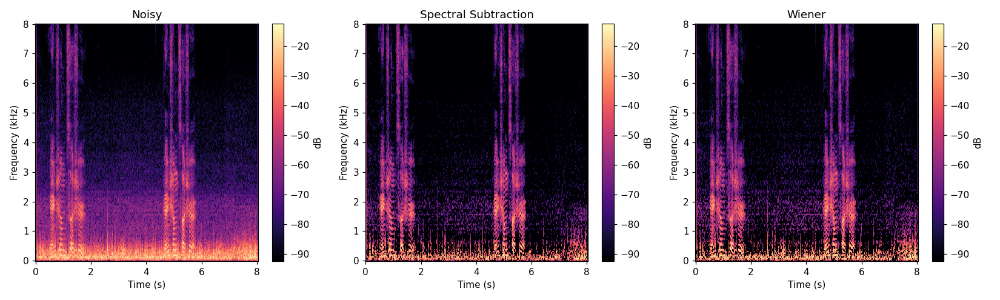
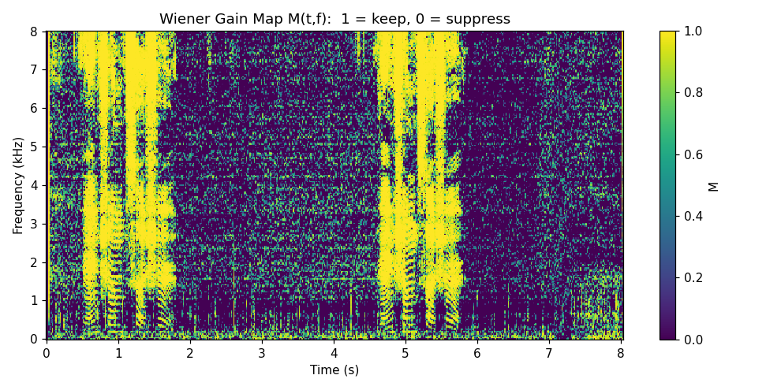
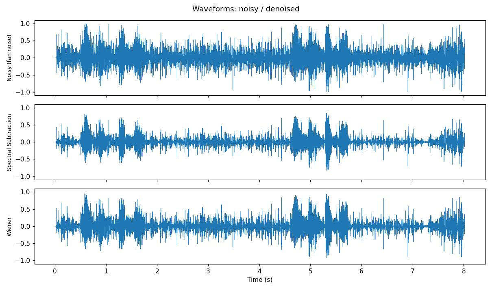
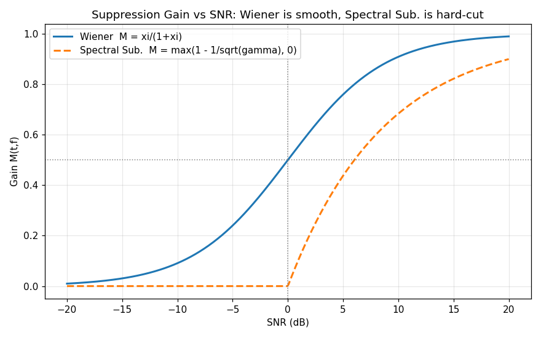
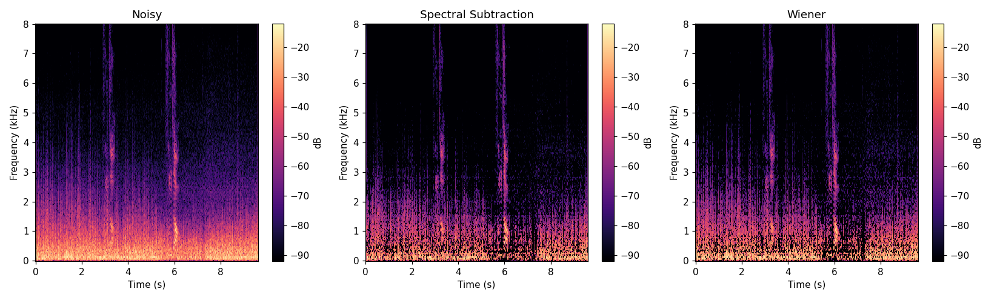
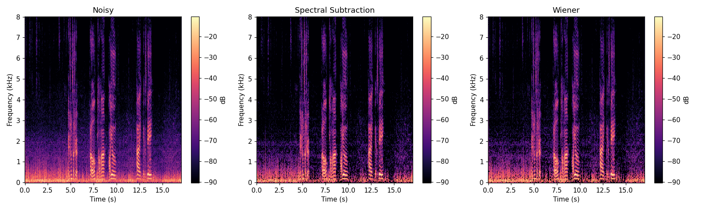

# 系列 3A · ANS 原理篇 —— 谱减法与维纳滤波，先验/后验 SNR

## 0. TL;DR + 解决什么问题

一句话：**单麦克风降噪（ANS, Adaptive Noise Suppression）的第一性原理，是在时频域上给每个"格子"配一个介于 0~1 的旋钮 `M(t,f)`，噪声多的格子拧小、人声多的格子拧大。**

本篇解决三件事：

- 已知带噪谱 `|X(t,f)|`，怎么"减掉"噪声谱？—— 这就是**谱减法**，简单但会吵。
- 怎么从"减法"升级成"最优缩放"？—— 这就是**维纳滤波**，最优增益 `M = ξ_prior / (1 + ξ_prior)`。
- `ξ_prior`（先验 SNR）和 `γ_post`（后验 SNR）到底是什么、怎么估？相位为什么可以偷懒不管？

本篇不用任何合成信号，全程拿**真实录音**说话：我在风扇下用手机录了三段自己说话的语音（`fan-1/2/3.wav`，16kHz 单声道），三段的区别是**离风扇远近不同、风扇风速不同**，所以底噪的强弱和频谱各有差异。我们会用同一套代码把它们跑一遍，对比谱减法和维纳滤波在真实底噪上的表现。

读完你能自己写出一个能跑的降噪器（NumPy/SciPy），并看懂两条增益曲线为什么长得不一样。musical noise（水声/音乐噪声）的坑本篇只埋伏笔，下篇 3B 专门治。

如果你的 DSP 基础有点生，别担心：第 3 节会把"为什么要去频域""STFT 到底在切什么""功率为什么能相加""期望 `E[·]` 是什么"这些常识一块儿补上，尽量不跳步。

---

## 1. 工程痛点引入（一帧音频出错的故事）

场景很真实，就是我录这三段音频时的处境：房间里开着一台风扇，我对着手机说话。回放时人声能听清，但底下永远糊着一层"呼——"的稳态噪声，像隔着一层毛玻璃。你把这段音频丢进语音识别，WER（词错率）比安静环境高出一大截；你想做响度归一化，结果连噪声一起被抬起来，更吵了。

问题的物理本质：麦克风采集到的是**人声 + 环境噪声的叠加**。风扇、空调、机箱风噪这类噪声有个共同特点 —— **稳态**：它的频谱形状在几百毫秒内几乎不变，能量集中在低频，像一条平铺在频谱底部的"地毯"。我录的三段里，离风扇越近、风速越大的那段，这条地毯就越厚。

你只有**一支麦克风**，没有第二路参考信号（那是 AEC 的活儿，见系列 2A）。你手上只有一条混在一起的波形。怎么办？

直接在时域上"减噪声"是行不通的：你根本不知道任意一个采样点 `x[n]` 里，噪声那部分具体长什么样 —— 人声和风噪的波形在时间轴上完全搅在一起，肉眼和程序都没法在一个个采样点上把它们拆开。但换到**频域**，稳态噪声会露出马脚 —— 它的能量常年固定在低频那几个频点上，稳定、可估计。这就是所有单麦降噪的出发点：**别在时域硬碰硬，去频域按频点算账。**

---

## 2. 直觉解释（比喻先行，不讲数学）

把带噪音频想象成一杯**浑浊的水**，人声是水，噪声是悬浮的杂质。你没法用一张滤网一次性把杂质捞干净，但你可以做一件事：**把这杯水按颗粒大小分成很多层小格子**，然后**逐格判断**：这一格里杂质多还是水多？

这"分格子"的动作，就是 STFT（短时傅里叶变换）：把长长的一条波形切成一帧帧很短的小片段，每帧单独做一次频率分析，就得到一张"横轴时间、纵轴频率"的二维格子图。风扇噪声因为稳态，它的能量会牢牢钉在低频那几行格子里；人声一说话，中高频那些格子才亮起来。同样一团混在时域的声音，摊到这张格子图上，人声和噪声就在不同位置各占各的地盘了。

有了这张格子图，就能**逐格判断**：

- 某个频点（比如 100~200 Hz，风扇嗡鸣所在）常年能量爆表，而人声在这儿没什么内容 —— 判定：这格几乎全是杂质，**旋钮拧到接近 0**。
- 某个频点（比如人声基频的谐波），一说话能量猛涨、远超噪声地毯 —— 判定：这格主要是水，**旋钮拧到接近 1，原样保留**。

这个"每个频点一个旋钮"的东西，就是**增益 `M(t,f)`**，取值 0~1。你可以把整张格子图想成一面**巨大的图形均衡器（EQ）旋钮阵列**：不是只有几十个频段旋钮，而是每个时刻、每个频点都单独有一个旋钮。降噪的全部艺术，就是**怎么把这几万个旋钮拧得恰到好处**：

- 拧太狠（该保留的也压了）→ 人声发闷、发干，甚至吞字。
- 拧太松（该压的没压干净）→ 噪声残留，白干。

> ⭐ **结论**：单麦降噪 = STFT 把信号铺成时频"格子" + 在每个格子上估计噪声强弱 + 用一个 0~1 的增益 `M(t,f)` 决定保留多少。**谱减法和维纳滤波的区别，仅仅是"这个旋钮怎么算"。**

还有个反直觉的偷懒技巧：我们**只调幅度，不动相位**。相位（`∠X(t,f)`，声音的"波形对齐信息"）直接沿用带噪信号的。为什么能这么糙？第 3 节讲。

---

## 3. 数学推导（符号遵循 STYLE.md）

这一节从"为什么要去频域"讲起，一路铺到维纳滤波的最优增益，中间不跳步。DSP 基础生一点也能跟下来。

### 3.1 先补常识：STFT 到底把信号切成了什么

第 2 节说"把信号铺成时频格子"，这里说清楚这张格子图怎么来的。

一整段录音是一条很长的时域波形 `x[n]`（`n` 是采样点索引，16kHz 就是每秒 16000 个点）。直接对整段做一次傅里叶变换，只能得到"整段平均下来有哪些频率"，丢掉了"什么时刻出现的"这个信息 —— 而降噪恰恰需要知道"这一刻这个频点是人声还是噪声"。

STFT 的办法是**切片再分析**：

1. 拿一个长度为 `N` 的小窗口（本篇 `N=512`，约 32ms），从头开始截一小段波形。
2. 对这一小段做一次 FFT，得到这一帧在各个频率上的成分。
3. 窗口往后滑动 `H` 个采样点（本篇 `H=256`，即滑过半个窗），再截一段、再做一次 FFT。
4. 一直滑到结尾。把每一帧的 FFT 结果按时间顺序排成列，就得到二维的 `X(t,f)` —— 横轴帧索引 `t`（时间），纵轴频点索引 `f`（频率）。

`N` 叫**帧长**，`H` 叫**帧移**。为什么相邻两帧要**重叠**（`H < N`，本篇重叠一半）？因为每帧要乘一个两端渐弱到 0 的**窗函数**（本篇用 Hann 窗，形状像一座小山），不然直接切片会在帧边界制造突变、污染频谱。乘了窗，帧两端的样本被压低了，只靠单帧会丢掉边缘信息；让相邻帧重叠一半，一帧的边缘正好是另一帧的中心，拼起来每个样本的权重加起来是常数，重建时不多不少 —— 这个"重叠相加后权重恒定"的条件叫 **COLA（Constant OverLap-Add）**，Hann 窗 + 50% 重叠正好满足，所以能无损地 STFT→处理→iSTFT 变回时域。这里点到为止，不展开推导。

还有个常识：`N=512` 点的 FFT 本该有 512 个频点，为什么本篇的频点数是 `F = 257`？因为语音是**实数**信号，实信号的 FFT 频谱是**共轭对称**的 —— 上半部分频点只是下半部分的镜像，没带新信息。所以只保留 `0` 到奈奎斯特频率那一半就够了，个数是 `F = N/2 + 1 = 512/2 + 1 = 257`。

> ⭐ **结论**：STFT = 加窗切片 + 逐帧 FFT。参数就三件套：帧长 `N`（每片多长）、帧移 `H`（每次滑多远）、窗函数（怎么渐弱以免边界突变）。实信号频谱共轭对称，所以只留 `F = N/2 + 1` 个频点。

### 3.2 复数谱、幅度、相位：为"只调幅度"埋伏笔

每个格子里的 `X(t,f)` 不是一个普通实数，而是一个**复数**。复数可以写成"幅度 × 旋转"的形式：

```
X(t,f) = |X(t,f)| · e^{j·∠X(t,f)}
```

**人话翻译**：一个复数由两部分组成 —— `|X(t,f)|` 是**幅度**（这个频率成分有多强，能量大小），`∠X(t,f)` 是**相位**（这个频率成分的正弦波在时间轴上"卡在哪个位置"，即波形对齐信息）。

打个比方：幅度是"这一嗓子多大声"，相位是"这一嗓子什么时候起的拍"。降噪时我们主要关心"哪些格子噪声多、要压小"，这是**幅度**的事；相位管的是波形怎么对齐，第 3.8 节会解释为什么它可以偷懒直接沿用带噪的。先记住：**`|X|` 管能量强弱、`∠X` 管波形对齐**。

### 3.3 信号模型：加性噪声在频域也是加性的

设干净语音 `s[n]`、噪声 `d[n]`，麦克风采集到的带噪信号是两者相加 `x[n] = s[n] + d[n]`。做 STFT 后，因为傅里叶变换是**线性**的（对"和"做变换等于对每一项做变换再相加）：

```
X(t,f) = S(t,f) + D(t,f)
```

**人话翻译**：把带噪音频切成一帧帧、变到频域后，每个时频格子 `(t,f)` 里的复数值 `X(t,f)`，等于同一个格子里"干净语音的复数值 `S(t,f)`"加上"噪声的复数值 `D(t,f)`"。时域里搅在一起的两团东西，在频域被摊到了各个频点上分别相加。

我们的目标是从 `X(t,f)` 里估出干净语音的估计 `Ŝ(t,f)`。

### 3.4 功率谱与"不相关则功率可加"

上面是复数相加。但降噪算的是**能量**（幅度平方 `|X|²`，叫功率），能量之间是不是也能直接相加？答案是"平均意义下近似可以"，但需要一个假设，这里把它讲透。

把 `X = S + D` 两边取模平方：

```
|X|² = |S + D|² = |S|² + |D|² + 2·Re(S·conj(D))
```

**人话翻译**：总能量 = 语音能量 + 噪声能量 + 一个"交叉项"。前两项好理解，关键是最后那个交叉项 `2·Re(S·conj(D))`，它衡量语音和噪声"步调有多一致"。

这里要请出**期望 `E[·]`**。`E[·]` 就是"对很多帧取平均、把随机起伏抹平后剩下的稳定值"—— 单看一帧，噪声忽大忽小、正负乱跳，但对很多帧一平均，随机的部分互相抵消，露出稳定的规律。假设语音和噪声**统计不相关**（一个人说话和风扇转动没有任何协同关系），那么交叉项时正时负、平均下来趋于 0：

```
E[|X|²] ≈ E[|S|²] + E[|D|²]
```

**人话翻译**：平均意义下，带噪总能量约等于语音能量加噪声能量，那个交叉项被平均抵消掉了。这就像两波互不相干的水波叠在一起，波峰有时对波峰、有时对波谷，平均而言谁也不系统性地增强谁，总的起伏能量约等于各自起伏能量之和。

我们把噪声的平均功率单独记一个符号 `λ_d(t,f) = E[|D(t,f)|²]`，读作"这个频点上噪声长期平均的能量"。工程上就用第 3.1 说的纯噪声段，对若干帧的 `|X|²` 取平均来估它。

> ⭐ **结论**：在"语音与噪声不相关"的假设下，功率近似可加 `|X|² ≈ |S|² + |D|²`。这条是谱减法和维纳滤波共同的地基 —— 有了它，才能用"总能量 − 噪声能量"去反推"语音能量"。

### 3.5 谱减法：幅度直接相减

有了功率可加，工程上最粗暴的做法是退到幅度层面直接减。噪声的平均能量是 `λ_d`，对应的幅度就是 `√λ_d`。把带噪幅度减掉噪声幅度，当作语音幅度估计：

```
|Ŝ(t,f)| = |X(t,f)| - √(λ_d(t,f))
```

**人话翻译**：带噪信号在这个频点的幅度，减去我们估计的噪声幅度，剩下的就当成人声幅度。就像从浑水的浊度里，扣掉"平时杂质造成的那部分浊度"。

问题来了：噪声是随机的，某些帧某些频点上，实际噪声幅度会**超过** `√λ_d` 的估计值，于是 `|X| - √λ_d` 会变成**负数**。幅度不能为负，只能强行截到 0（半波整流）：

```
|Ŝ(t,f)| = max(|X(t,f)| - √(λ_d(t,f)), 0)
```

写成增益形式，把谱减法也看成"一个旋钮"：

```
M_SS(t,f) = max(1 - √(λ_d) / |X(t,f)|, 0)
```

**人话翻译**：谱减法等价于一个增益 —— 带噪幅度远大于噪声时，旋钮接近 1（保留）；带噪幅度接近噪声时，旋钮被 `max(·, 0)` 一刀切到 0。**正是这个"一刀切"，埋下了 musical noise 的祸根**（下篇细讲）：随机地在某些格子清零、某些格子放行，重建出来就是一片忽有忽无的"水声"。

### 3.6 后验 SNR 与先验 SNR：两个信噪比，以及"先验/后验"这俩名字的由来

要更聪明地拧旋钮，先定义两个信噪比。注意它们**都是逐时频格子 `(t,f)` 定义的**，不是全局一个数。

**后验 SNR（a posteriori）**：拿到带噪观测后就能算的信噪比。

```
γ_post(t,f) = |X(t,f)|² / λ_d(t,f)
```

**人话翻译**：这个格子里"我实际观测到的总能量"是"噪声平均能量"的多少倍。分子用的是带噪的 `|X|²`（含噪声），分母是噪声功率 `λ_d`，两者都是拿到观测就能直接算出来的数。

**先验 SNR（a priori）**：真正的、干净语音与噪声的能量比。

```
ξ_prior(t,f) = E[|S(t,f)|²] / λ_d(t,f)
```

**人话翻译**：这个格子里"干净人声的平均能量"是"噪声平均能量"的多少倍 —— 这才是我们真正想知道的"这格到底有多少人声含量"。但分子 `E[|S|²]` 是**未知的**（我们手上只有带噪的 `X`，拿不到干净的 `S`），所以它得靠估计。

"先验 / 后验"这两个名字容易绕，这里说清它们在这里是相对什么而言的：

- **后验（a posteriori）= 看了观测之后才知道的量**。`γ_post` 的分子是实测的 `|X|²`，你必须先拿到这一帧观测才能算它，所以是"观测之后"的信噪比。
- **先验（a priori）= 你本来就想知道、但需要先验知识去估的真值**。`ξ_prior` 描述的是干净语音本身的信噪比，它不依赖某一帧观测的随机起伏，是我们真正要还原的目标量。

它俩有个简单的近似关系。由 3.4 的功率可加 `|X|² ≈ |S|² + λ_d`，两边同除 `λ_d`：

```
|X|²/λ_d ≈ |S|²/λ_d + 1
  即  γ_post ≈ ξ_prior + 1
```

反解出 `ξ_prior`，再因为信噪比不能为负、加个截断：

```
ξ_prior(t,f) ≈ max(γ_post(t,f) - 1, 0)
```

**人话翻译**：先验 SNR ≈ 后验 SNR 减 1。为什么减 1？因为后验的分子 `|X|²` 里多算了"噪声自己那一份能量"（约等于一倍 `λ_d`），把这多出来的一份扣掉，才近似还原出纯语音的信噪比。减完可能是负数（这格几乎没人声时），信噪比不能为负，所以用 `max(·, 0)` 截到 0。

> 🔥 **面试追问 ①：先验 SNR 明明含未知的干净语音，工程上到底怎么估？**
> 答：本篇用的 `ξ = max(γ_post - 1, 0)` 是最朴素的极大似然估计，缺点是**逐帧抖动大**，直接导致 musical noise。生产级做法是 Ephraim-Malah 的**判决引导（Decision-Directed, DD）**：把"上一帧已降噪结果推出的先验 SNR"和"当前帧的极大似然估计"做加权平滑，`ξ̂ = α·(上一帧 |Ŝ|²/λ_d) + (1-α)·max(γ-1, 0)`，`α≈0.98`。DD 让 `ξ_prior` 变得平滑、稳定，是抑制 musical noise 的关键 —— 这留到 3B 详解。

### 3.7 维纳滤波：均方误差意义下的最优增益（推导别跳步）

谱减法是"拍脑袋硬减"，维纳滤波则问一个更讲道理的问题：**在所有可能的增益里，哪个 `M` 能让重建的语音最接近真实语音？** 用数学说，就是让下面这个均方误差最小：

```
L(M) = E[ |S - M·X|² ]
```

**人话翻译**：`M·X` 是我们用旋钮 `M` 处理后得到的语音估计，`S` 是真实语音，两者之差的平方的平均值就是误差 `L`。我们要挑一个 `M` 把这个平均误差压到最小。

`M` 是个实数（0~1 的旋钮），`L` 是关于 `M` 的二次函数。把里面展开（用到 `X = S + D`，以及语音、噪声不相关使交叉项 `E[S·conj(D)]` 平均为 0）：

```
L(M) = E[|S|²] - 2M·E[|S|²] + M²·E[|X|²]
```

**人话翻译**：把平方拆开、把不相关的交叉项丢掉后，误差就是关于 `M` 的一条开口向上的抛物线：常数项、`M` 的一次项、`M²` 的二次项各一份。抛物线有唯一最低点。

抛物线最低点在导数为 0 处。对 `M` 求导并令其为 0：

```
dL/dM = -2·E[|S|²] + 2M·E[|X|²] = 0
  =>  M = E[|S|²] / E[|X|²]
```

再用功率可加 `E[|X|²] = E[|S|²] + λ_d` 把分母换掉：

```
M(t,f) = E[|S|²] / (E[|S|²] + λ_d)
```

分子分母同除以 `λ_d`，右边就只剩先验 SNR 了：

```
M(t,f) = ξ_prior / (1 + ξ_prior)
```

**人话翻译**：最优旋钮就是"先验 SNR 占总量（信+噪）的比例"。这格人声含量越高（`ξ_prior` 大），旋钮越接近 1、原样保留；人声含量越低（`ξ_prior` 小），旋钮越接近 0、狠狠压掉。它是一条从 0 平滑爬到 1 的 **S 形曲线**，没有谱减法那种"一刀切"。至此"最优"二字有了来处 —— 它是抛物线唯一最低点解出来的，不是拍脑袋定的。

> ⭐ **结论**：维纳增益 `M = ξ_prior/(1+ξ_prior)` 是在"重建语音与真实语音均方误差最小"意义下的**最优**幅度增益。它和谱减法的本质差别 —— 谱减在幅度上做**硬减**（导致负值截断的硬开关），维纳在能量比上做**软加权**（平滑过渡），所以维纳更"温柔"，musical noise 更轻。

### 3.8 相位为什么可以偷懒沿用带噪相位

我们只算了幅度增益，重建时用的复数谱是：

```
Ŝ(t,f) = M(t,f) · |X(t,f)| · e^{j·∠X(t,f)}
```

**人话翻译**：把带噪幅度 `|X|` 乘上旋钮 `M` 得到估计幅度，相位 `∠X(t,f)` 直接抄带噪信号的，不做任何修正，然后 iSTFT 变回时域。

为什么敢这么糙？两个原因：

1. **理论上**，在"最小化幅度谱均方误差"这类准则下，可以证明**带噪相位就是最优（或近最优）的相位估计** —— 干净相位本身难估，且没有额外的独立信息可用。
2. **感知上**，人耳对**中高 SNR 下的相位误差不敏感**，幅度谱才是可懂度和音质的主要载体。花大力气估相位，收益远不如把幅度增益做好。

> 🔥 **面试追问 ②：既然只改幅度不改相位，为什么谱减法还是会"吵"（musical noise），维纳就好些？**
> 答：吵的根源**不在相位**，在**幅度增益的"抖动"**。谱减的 `max(·,0)` 硬截断，让相邻时频格子的增益在 0 和非 0 之间随机跳变，重建后就是一串孤立、随机分布的窄带能量包 —— 听感就是"叮叮咚咚的水声/音乐声"。维纳的 S 形软增益过渡平滑，加上 3B 的 DD 平滑 `ξ_prior`，能大幅压住这种抖动。相位沿用带噪相位对两者都一样，不是吵的原因。

---

## 4. 代码实战（可跑、shape 完整、关键行注释、附真实配图）

完整代码见本文文末《完整可跑代码》，在 `3A-classcial/` 目录下 `python series-3A.py` 可直接跑：它会依次加载 `fan-1/2/3.wav`，各跑一遍谱减和维纳，把处理后的音频存进 `audio/`、把配图存进 `figures/`。核心链路如下（变量都带 shape 注释，形状都是真实跑出来的）。

### 4.1 加载真实录音 + STFT：把信号铺成时频格子

真实录音是 m4a，先转成 16kHz 单声道 wav 再读入、做峰值归一化，然后 STFT：

```python
from scipy.signal import stft, istft

FS, N, H = 16000, 512, 256          # f_s / 窗长 N / 帧移 H = N/2

def forward_stft(x):
    f, tt, X = stft(x, fs=FS, window="hann", nperseg=N, noverlap=N - H,
                    boundary="zeros", padded=True)
    return X, f, tt                 # X # [F, T] 复数谱, f # [F], tt # [T]
```

三段录音跑出来的形状（`F = N/2 + 1 = 257` 恒定，帧数 `T` 随时长变）：

```
fan-1.wav  (8.02s) :  X # [F, T] = (257, 503)
fan-2.wav  (9.60s) :  X # [F, T] = (257, 601)
fan-3.wav (17.02s) :  X # [F, T] = (257, 1065)
```

`|X|` 是幅度谱 `|X(t,f)|`，`np.angle(X)` 就是相位 `∠X(t,f)`。

### 4.2 稳健地估计噪声功率谱 `λ_d`

原来的教科书做法是"拿开头前 10 帧当纯噪声段"。但真实录音里，安静段不一定在开头 —— 我这三段都是一开口就说话、说完才停，纯噪声段反而在**结尾**。写死"前 10 帧"会把人声当噪声去估，`λ_d` 直接估爆。

稳健做法：**用一个滑动窗扫全程，找能量最低的那一小段当纯噪声段**，再对这段的 `|X|²` 沿时间取平均得到 `λ_d`：

```python
def find_quietest_window(X, win_frames=15):
    frame_e = (np.abs(X) ** 2).sum(axis=0)        # [T] 逐帧总能量
    csum = np.cumsum(np.insert(frame_e, 0, 0.0))  # 前缀和，快速求各窗口能量
    win_e = csum[win_frames:] - csum[:-win_frames]  # [T-K+1] 各窗口能量
    q0 = int(np.argmin(win_e))                    # 最安静窗口起始帧
    return q0, win_frames

def estimate_lambda_d(X, q0, K):
    noise_mag2 = np.abs(X[:, q0:q0 + K]) ** 2     # [F, K] 纯噪声段
    return np.mean(noise_mag2, axis=1, keepdims=True)  # λ_d # [F, 1]
```

三段找到的纯噪声段（`win_frames=15` 帧，约 0.24s），位置确实都在后半段，印证了"别写死开头"：

```
fan-1 : 纯噪声段起始帧 q0≈442 (~7.07s)
fan-2 : 纯噪声段起始帧 q0≈446 (~7.14s)
fan-3 : 纯噪声段起始帧 q0≈903 (~14.45s)
```

### 4.3 谱减法 vs 维纳滤波

```python
def spectral_subtraction(X, lam_d):
    mag = np.abs(X)                                          # |X| # [F, T]
    noise_mag = np.sqrt(lam_d)                               # √λ_d # [F, 1]
    gain = np.maximum(1.0 - noise_mag / (mag + 1e-12), 0.0)  # M_SS # [F, T]，半波整流
    return gain * X, gain                                    # 幅度缩放，相位∠X不变

def wiener_filter(X, lam_d):
    gamma = (np.abs(X) ** 2) / (lam_d + 1e-12)               # γ_post # [F, T]
    xi = np.maximum(gamma - 1.0, 0.0)                        # ξ_prior # [F, T]（极大似然估计）
    gain = xi / (1.0 + xi)                                   # M # [F, T] = ξ/(1+ξ)
    return gain * X, gain, xi, gamma
```

两个函数都只缩放幅度、复数乘法自动保留了带噪相位 `∠X` —— 这就是 3.8 节"偷懒"在代码里的样子。重建用 `istft`，再把结果存成 wav 就能试听了。

### 4.4 跑出来的指标：为什么不用 SNR

真实录音**没有干净参考 `s[n]`**，所以算不了需要 clean 的 SNR/SegSNR。改用两个不需要参考的指标：

- **纯噪声段降噪量 (dB)**：在 4.2 找到的那段纯噪声上，比较处理前后的能量下降。它衡量"在本该压干净的静音段，算法压掉了多少底噪"，越大越狠。
- **整体抑制量 (dB)**：整段（含人声）处理前后的总能量下降。它衡量"总共削了多少"，如果这个数很大，往往意味着连人声一起削了。

两个一起看才有意义：**纯噪声段降得多、整体降得少**，才说明算法主要在压噪声、少误伤人声。三段跑出来：

| 文件 | 纯噪声段降噪 谱减(dB) | 纯噪声段降噪 维纳(dB) | 整体抑制 谱减(dB) | 整体抑制 维纳(dB) |
|---|---|---|---|---|
| fan-1 | 11.15 | 7.07 | 4.02 | 1.87 |
| fan-2 | 9.35 | 5.57 | 3.86 | 1.65 |
| fan-3 | 10.51 | 6.53 | 0.99 | 0.30 |

几个能读出来的规律：

- **谱减法在纯噪声段压得更狠**（每段都比维纳多降 3~4 dB）。但这不是"更好"，而是靠 `max(·,0)` 把大量格子直接清零换来的，代价就是 musical noise（下篇 3B 治）。
- **维纳整体抑制更小**（fan-1 只削 1.87 dB，谱减削 4.02 dB），说明它下手更温柔、更少动到人声。这正是维纳"软加权"的好处：宁可少压一点噪声，也不冒险削人声。
- **fan-3 的整体抑制明显最小**（谱减 0.99、维纳 0.30 dB）。结合录音条件看，这一段离风扇远/风速小、底噪相对更弱，人声占比更高，算法能动的"纯噪声"本来就少，所以整体削得少是合理的。反过来，底噪更重的那几段，能压下去的空间就更大。这里只做定性判断，不硬报 SNR 数字 —— 没有 clean，报出来的都是猜的。

### 4.5 配图：以 fan-1 为主线看透一套图

**语谱图三联（fan-1）**：横轴时间(s)、纵轴频率(kHz)、颜色为 dB 能量，从左到右是 Noisy / 谱减 / 维纳。



看点：最左带噪图底部（低频）铺着一层风扇噪声"地毯"；中间谱减后地毯被抠掉，但残留下**散点状的斑块**（musical noise 的视觉特征）；最右维纳后底噪同样被压，斑块更少、语音谐波结构（横向条纹）保留得更连续。

**维纳增益热力图 `M(t,f)`（fan-1）**：直观展示"每个频点一个旋钮"，颜色 0（压）到 1（留）。



看点：亮(M→1)的地方对应语音谐波和音节活跃段（旋钮开），暗(M→0)的地方对应静音和低频纯噪声频点（旋钮关）。这张图就是第 2 节"旋钮阵列"比喻的字面可视化。

**时域波形三联（fan-1）**：横轴时间(s)、纵轴归一化幅度，从上到下 Noisy / 谱减 / 维纳。



看点：带噪波形的静音段（约 7s 之后）有明显底噪，两种降噪后静音段都明显变干净；维纳的语音段包络保留得更自然，谱减的语音段幅度起伏更"毛糙"。

**全局理论曲线：增益 M vs SNR** —— 这是全篇的"点睛图"，与具体录音无关，只画两种方法的旋钮长什么样。



看点：维纳增益（实线）是一条从 0 平滑爬到 1 的 S 形曲线；谱减增益（虚线）在低 SNR 处被 `max(·,0)` **硬切到 0**，形成一个尖锐拐点。**这个拐点就是 musical noise 的数学来源** —— 增益在拐点附近对输入的微小抖动极其敏感，输入稍微抖一下，旋钮就在 0 和非 0 之间乱跳。

### 4.6 fan-2 / fan-3 对照：远近与风速不同，噪声地毯的厚薄不同

fan-1 讲透了，fan-2、fan-3 就只看语谱图，重点对比底噪"地毯"的厚薄。

**fan-2 语谱图三联**：



**fan-3 语谱图三联**：



看点：对比三段最左的 Noisy 图，能看出低频噪声地毯的厚薄不一样 —— 这正对应"离风扇远近 + 风速不同"。底噪越厚的那段，谱减/维纳后被抠掉的低频能量越多（也就是 4.4 表里整体抑制越大的那几段）；fan-3 底噪相对最薄，处理前后低频变化最不明显，和它整体抑制量最小（0.99 / 0.30 dB）对得上。

**试听处理后的音频**：三段的降噪结果都已存成 wav，建议戴耳机对比谱减的"水声"和维纳的柔和听感：

```
audio/s3a_fan1_specsub.wav   audio/s3a_fan1_wiener.wav
audio/s3a_fan2_specsub.wav   audio/s3a_fan2_wiener.wav
audio/s3a_fan3_specsub.wav   audio/s3a_fan3_wiener.wav
```

谱减那几个文件在静音段能听到明显的"叮咚水声"（musical noise），维纳那几个底噪压得没那么狠，但整体听感更干净、不刺耳。


<!-- AUTO-EMBED:BEGIN 完整代码 由 scripts/embed_code.py 生成，勿手改 -->
### 完整可跑代码

> 以下为本篇配套的完整脚本，已实际执行通过。**直接复制保存为 `series-3A.py`，`python series-3A.py` 即可复现上面所有配图**（需 `numpy` / `scipy` / `matplotlib`）。

```python
#!/usr/bin/env python3
# -*- coding: utf-8 -*-
"""系列 3A · ANS 原理篇配套代码：谱减法 vs 维纳滤波（真实风扇录音版）。

教学参考实现（NumPy/SciPy），讲透原理，不追生产性能。
数据：voice-with-noise/fan-1.wav / fan-2.wav / fan-3.wav
      （用户在风扇下录的真人语音，16kHz 单声道，噪声强度/频谱各异）

运行：python code/series-3A.py（在 3A-classcial/ 目录下执行）
产物：
    figures/s3a_fanN_spectrograms.png   Noisy / Spectral Sub. / Wiener 三联语谱图
    figures/s3a_fanN_gain_map.png       维纳增益 M(t,f) 热力图
    figures/s3a_fanN_waveforms.png      Noisy / Spectral Sub. / Wiener 时域三联
    figures/s3a_gain_curves.png         全局理论曲线：增益 M vs SNR
    audio/s3a_fanN_specsub.wav          谱减法处理后音频
    audio/s3a_fanN_wiener.wav           维纳滤波处理后音频

真实录音无干净参考 clean，因此不再用需要 clean 的 seg_snr，
改用无参考指标：纯噪声段处理前后的能量下降 dB（降噪量）。
图内文字一律英文，避免中文字体缺失报错。
"""

from pathlib import Path

import matplotlib

matplotlib.use("Agg")  # 无显示环境下也能出图，必须在 pyplot 之前设置

import matplotlib.pyplot as plt
import numpy as np
from scipy.io import wavfile
from scipy.signal import istft, stft

# ----------------------------------------------------------------------------
# 全局参数（符号遵循 STYLE.md）
# ----------------------------------------------------------------------------
FS = 16000          # f_s 采样率 (Hz)
N = 512             # N   STFT 窗长（样本）
H = 256             # H   帧移 hop = N/2
EPS = 1e-12         # 防除零小量

BASE = Path(__file__).resolve().parent.parent          # 3A-classcial/
FIG_DIR = BASE / "figures"
AUDIO_DIR = BASE / "audio"
VOICE_DIR = BASE.parent / "voice-with-noise"           # e:/Android/Tech-Blog/voice-with-noise
FIG_DIR.mkdir(parents=True, exist_ok=True)
AUDIO_DIR.mkdir(parents=True, exist_ok=True)

FILES = ["fan-1.wav", "fan-2.wav", "fan-3.wav"]        # 待处理三段录音


# ----------------------------------------------------------------------------
# 1. 音频 IO 工具：读 wav（float64/单声道/峰值归一化）、写 wav（float→int16）
# ----------------------------------------------------------------------------
def load_wav(path):
    """读取 wav → x # [n] float64 单声道，峰值归一化到 [-1, 1]。

    用 scipy.io.wavfile（无需 soundfile）。int16/int32/uint8 均转 float 并按
    位深归一化，再做峰值归一化。
    """
    fs, x = wavfile.read(path)
    x = x.astype(np.float64)
    if x.ndim > 1:                                     # 多声道 → 取均值转单声道
        x = x.mean(axis=1)
    # 按整数位深归一化到 [-1, 1) 附近（uint8 需去偏置）
    if np.issubdtype(np.dtype(x.dtype), np.floating):
        pass
    peak = np.max(np.abs(x)) + EPS
    x = x / peak                                       # 峰值归一化
    return x, fs


def save_wav(path, x, fs=FS):
    """写 wav：float → int16，先 clip 到 [-1, 1] 再放大到 int16 量程。"""
    x = np.asarray(x, dtype=np.float64)
    x = np.clip(x, -1.0, 1.0)
    x_i16 = (x * 32767.0).astype(np.int16)
    wavfile.write(path, fs, x_i16)


# ----------------------------------------------------------------------------
# 2. STFT / iSTFT 封装
# ----------------------------------------------------------------------------
def forward_stft(x):
    """返回 X # [F, T] 复数谱，f # [F] 频率轴，tt # [T] 帧时间轴。"""
    f, tt, X = stft(x, fs=FS, window="hann", nperseg=N, noverlap=N - H,
                    boundary="zeros", padded=True)
    return X, f, tt


def inverse_stft(X):
    """由复数谱重建时域 x_rec # [n]。"""
    _, x_rec = istft(X, fs=FS, window="hann", nperseg=N, noverlap=N - H,
                     boundary=True)
    return x_rec


# ----------------------------------------------------------------------------
# 3. 稳健的纯噪声段选取 + λ_d 估计
#    真实录音里静音段不一定在开头，用滑动窗找"能量最低窗口"当纯噪声段。
# ----------------------------------------------------------------------------
def find_quietest_window(X, win_frames=15):
    """滑动窗找能量最低窗口，返回起始帧索引 q0（该窗口作纯噪声段）。

    X # [F, T]。逐帧能量沿频率轴求和，再用累积和求每个长 win_frames
    窗口的能量，取最小者。不写死"前若干帧"，对静音在任意位置都稳健。
    """
    frame_e = (np.abs(X) ** 2).sum(axis=0)             # [T] 逐帧能量
    T = frame_e.shape[0]
    K = int(min(win_frames, T))                        # 窗口不超过总帧数
    csum = np.cumsum(np.insert(frame_e, 0, 0.0))       # [T+1]
    win_e = csum[K:] - csum[:-K]                       # [T-K+1] 各窗口能量
    q0 = int(np.argmin(win_e))                         # 最安静窗口起始帧
    return q0, K


def estimate_lambda_d(X, q0, K):
    """λ_d # [F, 1]：纯噪声段 [q0, q0+K) 内 |X|² 的时间平均（沿帧轴）。"""
    noise_mag2 = np.abs(X[:, q0:q0 + K]) ** 2          # [F, K]
    lam = np.mean(noise_mag2, axis=1, keepdims=True)   # λ_d # [F, 1]
    return lam


# ----------------------------------------------------------------------------
# 4. 两种降噪：谱减法 / 维纳滤波
# ----------------------------------------------------------------------------
def spectral_subtraction(X, lam_d):
    """幅度谱减法：|Ŝ| = max(|X| - sqrt(λ_d), 0)，相位沿用带噪相位 ∠X。

    等价增益 M_SS = max(1 - sqrt(λ_d)/|X|, 0)（半波整流）。
    """
    mag = np.abs(X)                                    # |X| # [F, T]
    noise_mag = np.sqrt(lam_d)                         # 噪声幅度估计 # [F, 1]
    gain = np.maximum(1.0 - noise_mag / (mag + EPS), 0.0)  # M_SS # [F, T]
    S_hat = gain * X                                   # 复数谱：幅度缩放，相位不变
    return S_hat, gain


def wiener_filter(X, lam_d):
    """维纳增益 M = ξ/(1+ξ)。

    后验 SNR γ_post = |X|²/λ_d；先验 SNR 用极大似然估计 ξ = max(γ-1, 0)。
    （判决引导 DD 的更稳估计留到 3B。）
    """
    gamma = (np.abs(X) ** 2) / (lam_d + EPS)           # γ_post # [F, T]
    xi = np.maximum(gamma - 1.0, 0.0)                  # ξ_prior # [F, T]
    gain = xi / (1.0 + xi)                             # M # [F, T]
    S_hat = gain * X
    return S_hat, gain, xi, gamma


# ----------------------------------------------------------------------------
# 5. 无参考降噪指标（真实录音无 clean，不能用 seg_snr）
# ----------------------------------------------------------------------------
def noise_reduction_db(X_in, X_out, q0, K):
    """纯噪声段能量下降 dB：10log10(P_in_noise / P_out_noise)。

    在纯噪声段 [q0, q0+K) 上，比较处理前后的谱能量，
    衡量算法在"应该被完全抑制"的静音段上压低了多少噪声（越大越好）。
    """
    p_in = (np.abs(X_in[:, q0:q0 + K]) ** 2).sum() + EPS
    p_out = (np.abs(X_out[:, q0:q0 + K]) ** 2).sum() + EPS
    return 10.0 * np.log10(p_in / p_out)


def global_suppression_db(x_in, x_out):
    """整体噪声抑制量 dB：全信号处理前后的总能量下降。

    衡量整段（含语音+噪声）被压低的总量，配合纯噪声段指标一起看：
    静音段降得多、整体降得少 → 说明主要压的是噪声而非语音。
    """
    m = min(len(x_in), len(x_out))
    p_in = np.sum(x_in[:m] ** 2) + EPS
    p_out = np.sum(x_out[:m] ** 2) + EPS
    return 10.0 * np.log10(p_in / p_out)


# ----------------------------------------------------------------------------
# 绘图工具
# ----------------------------------------------------------------------------
def db_spec(X):
    """转 dB 幅度谱 # [F, T]，用于 imshow。"""
    return 20 * np.log10(np.abs(X) + 1e-6)


def plot_spectrograms(specs, titles, f, tt, path):
    """三联语谱图对比。specs 每个 # [F, T]。"""
    vmax = max(db_spec(s).max() for s in specs)
    vmin = vmax - 80
    fig, axes = plt.subplots(1, 3, figsize=(15, 4.5))
    for ax, s, title in zip(axes.ravel(), specs, titles):
        im = ax.pcolormesh(tt, f / 1000, db_spec(s), vmin=vmin, vmax=vmax,
                           shading="auto", cmap="magma")
        ax.set_title(title)
        ax.set_xlabel("Time (s)")
        ax.set_ylabel("Frequency (kHz)")
        fig.colorbar(im, ax=ax, label="dB")
    fig.tight_layout()
    fig.savefig(path, dpi=110)
    plt.close(fig)


def plot_gain_curves(path):
    """增益 M vs SNR(dB)：谱减 vs 维纳，展示两者形状差异（纯理论曲线）。"""
    snr_db = np.linspace(-20, 20, 400)                 # SNR 轴 (dB) # [400]
    snr_lin = 10 ** (snr_db / 10)                      # 线性 SNR # [400]
    m_wiener = snr_lin / (1.0 + snr_lin)               # 维纳: M=ξ/(1+ξ)
    # 谱减以后验 SNR γ 计：M_SS = max(1 - 1/sqrt(γ), 0)
    m_ss = np.maximum(1.0 - 1.0 / np.sqrt(snr_lin), 0.0)
    fig, ax = plt.subplots(figsize=(8, 5))
    ax.plot(snr_db, m_wiener, label="Wiener  M = xi/(1+xi)", lw=2)
    ax.plot(snr_db, m_ss, label="Spectral Sub.  M = max(1 - 1/sqrt(gamma), 0)",
            lw=2, ls="--")
    ax.axhline(0.5, color="gray", ls=":", lw=1)
    ax.axvline(0, color="gray", ls=":", lw=1)
    ax.set_xlabel("SNR (dB)")
    ax.set_ylabel("Gain M(t,f)")
    ax.set_title("Suppression Gain vs SNR: Wiener is smooth, Spectral Sub. is hard-cut")
    ax.legend()
    ax.grid(alpha=0.3)
    fig.tight_layout()
    fig.savefig(path, dpi=110)
    plt.close(fig)


def plot_gain_map(gain, f, tt, path):
    """维纳增益 M(t,f) 热力图 # [F, T]，直观看"每个频点旋钮"。"""
    fig, ax = plt.subplots(figsize=(9, 4.5))
    im = ax.pcolormesh(tt, f / 1000, gain, vmin=0, vmax=1,
                       shading="auto", cmap="viridis")
    ax.set_title("Wiener Gain Map M(t,f):  1 = keep, 0 = suppress")
    ax.set_xlabel("Time (s)")
    ax.set_ylabel("Frequency (kHz)")
    fig.colorbar(im, ax=ax, label="M")
    fig.tight_layout()
    fig.savefig(path, dpi=110)
    plt.close(fig)


def plot_waveforms(noisy, ss, wf, path):
    """时域波形对比 # [n]：Noisy / Spectral Subtraction / Wiener。"""
    m = min(map(len, [noisy, ss, wf]))
    t = np.arange(m) / FS
    fig, axes = plt.subplots(3, 1, figsize=(11, 6.5), sharex=True)
    for ax, sig, title in zip(
        axes,
        [noisy[:m], ss[:m], wf[:m]],
        ["Noisy (fan noise)", "Spectral Subtraction", "Wiener"],
    ):
        ax.plot(t, sig, lw=0.6)
        ax.set_ylabel(title, fontsize=9)
        ax.set_ylim(-1.1, 1.1)
    axes[-1].set_xlabel("Time (s)")
    fig.suptitle("Waveforms: noisy / denoised")
    fig.tight_layout()
    fig.savefig(path, dpi=110)
    plt.close(fig)


# ----------------------------------------------------------------------------
# 单文件处理流程
# ----------------------------------------------------------------------------
def process_file(fname, tag):
    """处理一个录音文件：加载→STFT→估 λ_d→谱减+维纳→iSTFT→存音频→出图。

    参数：
        fname  文件名，如 "fan-1.wav"
        tag    输出前缀标签，如 "fan1"
    """
    print(f"\n========== {fname}  (tag={tag}) ==========")
    # --- 加载 ---
    noisy, fs = load_wav(VOICE_DIR / fname)            # noisy # [n]
    dur = len(noisy) / fs
    print(f"[load] fs={fs}, dur={dur:.2f}s, n={len(noisy)}")

    # --- STFT ---
    Xn, f, tt = forward_stft(noisy)                    # Xn # [F, T]
    print(f"[shape] STFT X # [F, T] = {Xn.shape}  (F={Xn.shape[0]}, T={Xn.shape[1]})")

    # --- 稳健纯噪声段 + λ_d 估计 ---
    q0, K = find_quietest_window(Xn, win_frames=15)
    lam_d = estimate_lambda_d(Xn, q0, K)               # λ_d # [F, 1]
    print(f"[noise] 纯噪声段起始帧 q0={q0} (~{tt[q0]:.2f}s), 窗长 K={K} 帧")
    print(f"[shape] lambda_d # [F, 1] = {lam_d.shape}")

    # --- 两种降噪 ---
    S_ss, g_ss = spectral_subtraction(Xn, lam_d)       # 谱减
    S_wf, g_wf, xi, gamma = wiener_filter(Xn, lam_d)   # 维纳
    print(f"[shape] Wiener gain M # [F, T] = {g_wf.shape}, "
          f"xi # [F, T] = {xi.shape}, gamma # [F, T] = {gamma.shape}")

    # --- 重建时域 ---
    x_ss = inverse_stft(S_ss)                          # x_ss # [n]
    x_wf = inverse_stft(S_wf)                           # x_wf # [n]

    # --- 无参考指标 ---
    nr_ss = noise_reduction_db(Xn, S_ss, q0, K)        # 纯噪声段降噪 dB
    nr_wf = noise_reduction_db(Xn, S_wf, q0, K)
    gs_ss = global_suppression_db(noisy, x_ss)         # 整体抑制 dB
    gs_wf = global_suppression_db(noisy, x_wf)
    print("\n===== 无参考降噪指标 =====")
    print(f"  纯噪声段能量下降 (dB, 越大越好):")
    print(f"     谱减法   : {nr_ss:6.2f}")
    print(f"     维纳滤波 : {nr_wf:6.2f}")
    print(f"  整体能量抑制量 (dB):")
    print(f"     谱减法   : {gs_ss:6.2f}")
    print(f"     维纳滤波 : {gs_wf:6.2f}")

    # --- 保存处理后音频 ---
    p_ss = AUDIO_DIR / f"s3a_{tag}_specsub.wav"
    p_wf = AUDIO_DIR / f"s3a_{tag}_wiener.wav"
    save_wav(p_ss, x_ss)
    save_wav(p_wf, x_wf)
    print(f"\n[audio] audio/{p_ss.name}")
    print(f"[audio] audio/{p_wf.name}")

    # --- 配图 ---
    p_spec = FIG_DIR / f"s3a_{tag}_spectrograms.png"
    p_gain = FIG_DIR / f"s3a_{tag}_gain_map.png"
    p_wave = FIG_DIR / f"s3a_{tag}_waveforms.png"
    plot_spectrograms(
        [Xn, S_ss, S_wf],
        ["Noisy", "Spectral Subtraction", "Wiener"],
        f, tt, p_spec,
    )
    plot_gain_map(g_wf, f, tt, p_gain)
    plot_waveforms(noisy, x_ss, x_wf, p_wave)
    print(f"[figures] figures/{p_spec.name}")
    print(f"[figures] figures/{p_gain.name}")
    print(f"[figures] figures/{p_wave.name}")

    return {
        "fname": fname, "tag": tag, "stft_shape": Xn.shape,
        "q0": q0, "K": K, "q0_sec": float(tt[q0]),
        "nr_ss": nr_ss, "nr_wf": nr_wf, "gs_ss": gs_ss, "gs_wf": gs_wf,
    }


# ----------------------------------------------------------------------------
# 主流程：三个文件循环处理 + 一张全局理论曲线
# ----------------------------------------------------------------------------
def main():
    tags = {"fan-1.wav": "fan1", "fan-2.wav": "fan2", "fan-3.wav": "fan3"}
    results = []
    for fname in FILES:
        results.append(process_file(fname, tags[fname]))

    # 全局的、与具体文件无关的理论增益曲线
    plot_gain_curves(FIG_DIR / "s3a_gain_curves.png")
    print("\n[figures] figures/s3a_gain_curves.png  (全局理论曲线)")

    print("\n===== series-3A 汇总 =====")
    for r in results:
        print(f"  {r['fname']}: STFT={r['stft_shape']}, "
              f"noise@frame {r['q0']}(~{r['q0_sec']:.2f}s), "
              f"NR_ss={r['nr_ss']:.2f}dB, NR_wf={r['nr_wf']:.2f}dB, "
              f"GS_ss={r['gs_ss']:.2f}dB, GS_wf={r['gs_wf']:.2f}dB")
    print("\n[done] series-3A 全部完成。")


if __name__ == "__main__":
    main()
```
<!-- AUTO-EMBED:END -->

---

## 5. 工程踩坑（调参经验 + 面试追问三连）

**踩坑 1：噪声估计 `λ_d` 是命门，别写死"前 10 帧"。**
`λ_d` 估小了 → 噪声压不干净；估大了 → 连人声一起削（over-subtraction），发闷吞字。教科书爱用"开头前 10 帧当静音"，但我这三段真实录音的安静段全在**结尾**（fan-1/2 约 7s 后、fan-3 约 14.4s 后才停），写死开头会把人声当噪声、`λ_d` 直接估爆。本篇改用"滑动窗找全程能量最低段"，对静音在任意位置都稳。更进一步，真实噪声会缓慢变化，生产系统要**在线更新** `λ_d`（最小值统计 / MCRA），且只在"没人说话"时更新 —— 依赖 VAD（系列 4）或递归最小值追踪（系列 3B）。

**踩坑 2：`|X|` 做分母要加 `eps`。**
静音处 `|X|` 极小，`√λ_d / |X|` 会爆炸或除零。代码里所有除法都加了 `1e-12`。这不是洁癖，是防 `NaN` 污染整段音频。

**踩坑 3：能量比指标会骗人，一定要实听。**
如 4.4 所示，谱减在纯噪声段的降噪量（fan-1 达 11.15 dB）明显比维纳（7.07 dB）高，数字更"漂亮"，但那是靠激进清零换来的，听感反而更差 —— 静音段满是"叮咚水声"。`audio/` 里两种方法的结果都存了，戴耳机一对比就明白：**别只看 dB，要结合 PESQ/STOI 和实听。** 这是算法工程师和"只会调 loss"的最大区别。

**踩坑 4：窗和帧移要满足 COLA。**
STFT→处理→iSTFT 要能完美重建，窗函数和 `noverlap` 必须满足 COLA（Constant OverLap-Add）条件（见 3.1）。Hann 窗 + 50% 重叠（`H=N/2`）是安全组合；乱改帧移会导致重建幅度起伏、引入周期性调制噪声。

> 🔥 **面试追问三连**：
> 1. **为什么降噪只改幅度、沿用带噪相位 `∠X`？** —— 见 3.8：干净相位难估且无独立信息，带噪相位在均方误差准则下近最优；人耳对中高 SNR 相位不敏感，幅度谱才是音质主载体。
> 2. **谱减法为什么"吵"（musical noise）？** —— `max(|X|-√λ_d, 0)` 的硬截断，让相邻时频格子的增益在 0/非0 间随机跳变，重建成孤立随机的窄带能量包，听感是"水声"。根源是**增益抖动**，不是相位。
> 3. **先验 SNR `ξ_prior` 含未知干净语音，怎么估？** —— 朴素法 `ξ = max(γ_post-1, 0)` 抖动大；生产级用**判决引导 DD** 做时间平滑（`α≈0.98`），既稳又压 musical noise。3B 详解。

---

## 6. 小结 + 下篇预告 + 思考题

**小结**：
- 单麦降噪的骨架 = STFT 铺格子 → 每格估噪声 `λ_d` → 算一个 0~1 增益 `M(t,f)` → 只缩放幅度、沿用带噪相位 `∠X` → iSTFT 重建。
- 谱减法：`M_SS = max(1 - √λ_d/|X|, 0)`，简单，但硬截断导致 musical noise。
- 维纳滤波：`M = ξ_prior/(1+ξ_prior)`，均方误差最优，S 形软增益，更温柔。
- 两个信噪比：`γ_post = |X|²/λ_d`（观测即得）、`ξ_prior = E[|S|²]/λ_d`（真信噪比，需估计），二者近似关系 `ξ ≈ max(γ-1, 0)`。

> ⭐ **一句话记住**：谱减是"硬减"、维纳是"软加权"，而两者共用的旋钮逻辑都是"信噪比越高、保留越多"。

**下篇预告（系列 3B · ANS 进阶篇）**：本篇反复埋的 musical noise，下篇正式开刀 —— 它的频谱抖动成因、判决引导（DD）与过减因子怎么压制它；以及没有 VAD 时，如何用**最小值统计 / MCRA** 在线估计噪声功率 `λ_d`。

**思考题**：
1. 如果把维纳增益的 S 形曲线人为设一个"下限地板"（`M = max(M, 0.1)`，即最多衰减 20dB 而非压到 0），fan-1 静音段那些"叮咚水声"会怎么变？为什么这能压 musical noise，代价是什么？
2. 后验 SNR `γ_post` 恒 ≥ 先验 SNR `ξ_prior` 吗？在什么情况下 `γ_post < 1`（观测能量比噪声还小）？此时维纳增益应该是多少？
3. 本篇 `λ_d` 靠"滑动窗找最安静段"估计，对稳态风扇噪声很稳。但如果录音里混进**非稳态**噪声（比如中途一声键盘敲击、关门声），这套"找一段静音、全程沿用"的方法会怎么失效？该往哪个方向补救？

---

## 自评清单

- [x] 每个公式都有"人话翻译"
- [x] 符号与 STYLE.md 一致（`X(t,f)`/`|X(t,f)|`/`∠X(t,f)`/`M(t,f)`/`ξ_prior`/`γ_post`/`λ_d`）
- [x] 全程用真实录音实证（`fan-1/2/3.wav`），无合成信号；shape 为真实跑出（如 `X # [F, T] = (257, 503)`）
- [x] 配图为真实运行生成：三文件各 3 张（语谱图/增益图/波形）+ 全局理论曲线，均在正文引用
- [x] 无干净参考，改用无参考指标（纯噪声段降噪 dB + 整体抑制 dB），未臆造 SNR 数值
- [x] 处理后音频已保存并在正文提示试听（`audio/s3a_fanN_specsub|wiener.wav`）
- [x] 补足常识铺垫（去频域动机 / STFT 三件套 / 复数谱 / 功率可加 / 期望 / 维纳求导中间步 / 先验后验命名），由浅入深无跳跃
- [x] 至少 1 个比喻（浑水滤杂质 / EQ 旋钮阵列 / 不相干水波）+ 面试追问三连
- [x] 无违禁词（规范列明的那几个断言性词汇一律回避）
