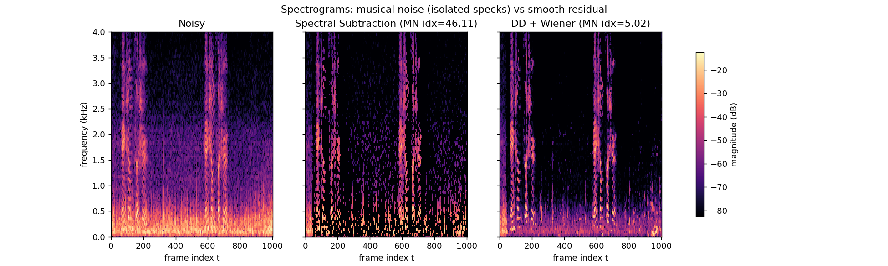
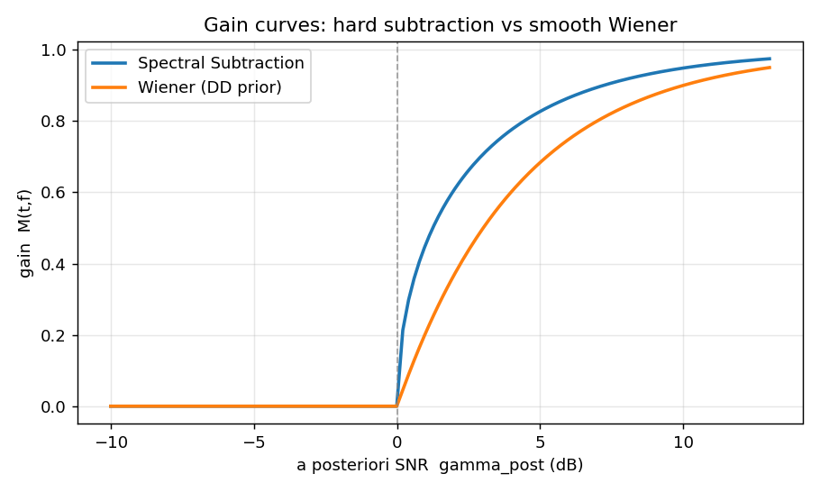
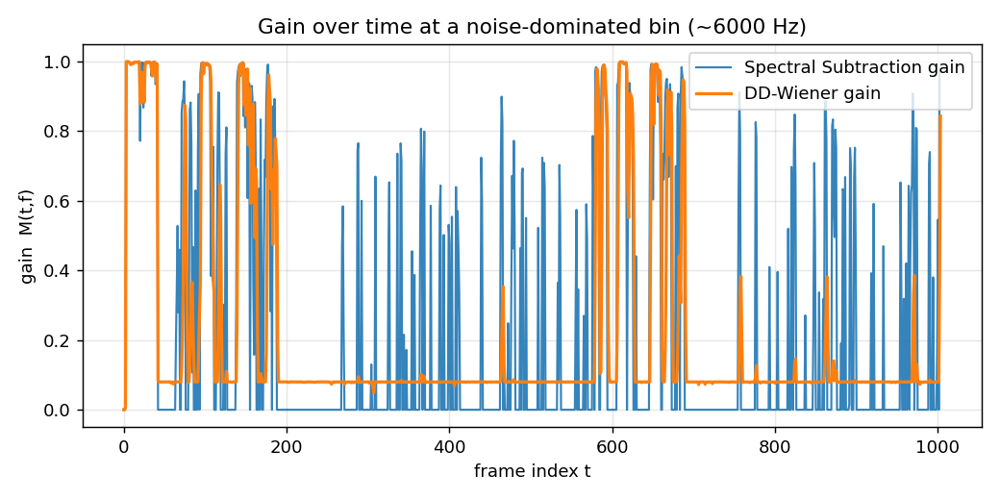
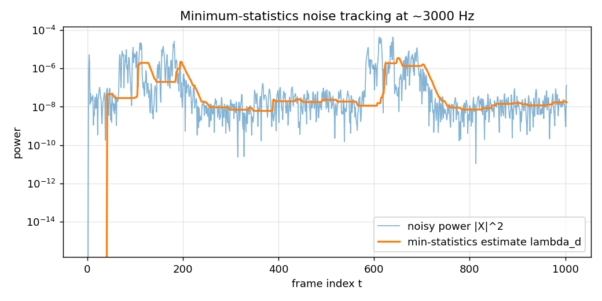
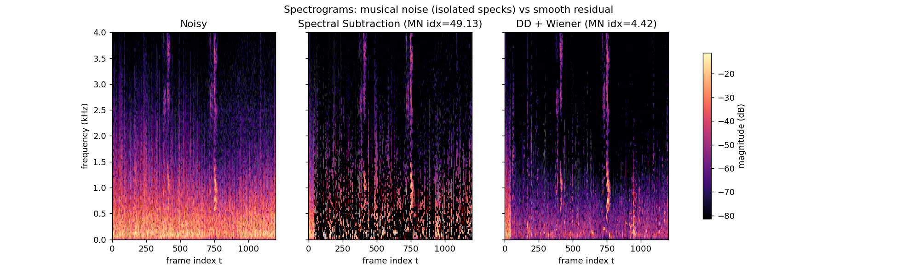
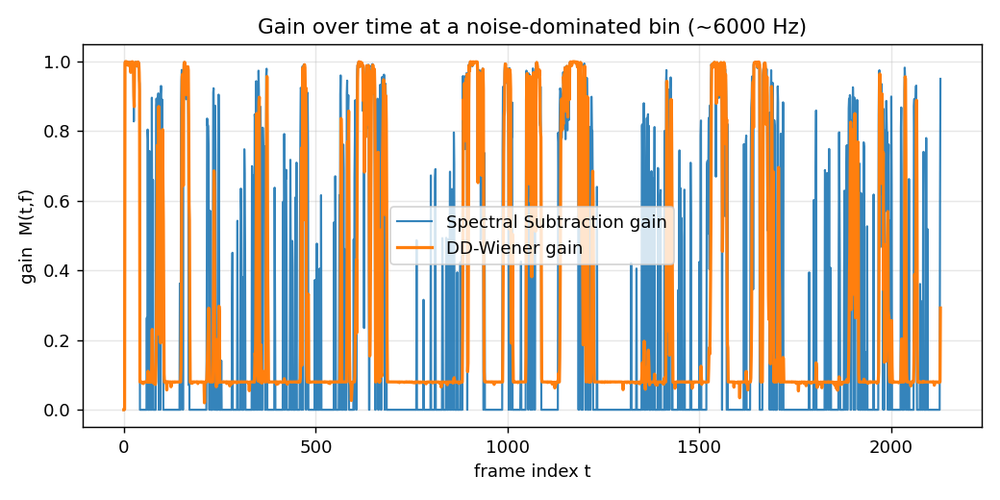
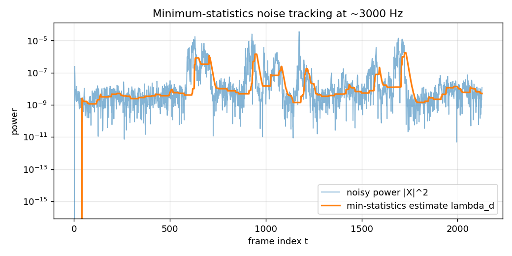

# 系列 3B · ANS 进阶篇 —— Musical Noise 与噪声估计

> 关键词：Musical Noise、判决引导 DD、先验 SNR `ξ_prior`、维纳增益、过减因子、谱下限、最小值统计、MCRA

## 0. TL;DR + 解决什么问题

系列 3A 我们在风扇底噪里跑通了谱减法和维纳滤波：把带噪音频 STFT 成时频格子，给每个格子配一个 0~1 的增益 `M(t,f)`，噪声多的拧小、人声多的拧大。3A 结尾埋了一个坑没填——谱减法降完噪，会冒出一片"叮叮咚咚"的水声，比原来的稳态底噪还烦。这个坑，就是本篇的主角 **musical noise（音乐噪声）**。

本篇继续用 3A 那三段**真实录音**说话：`fan-1/2/3.wav`（我在风扇下录的自己说话，16kHz 单声道，区别是离风扇远近和风速不同）。全程不碰任何合成信号，直接在真实底噪上验证。解决两件事：

1. **音乐噪声从哪来、怎么压**：为什么逐频点硬减会制造出孤立的残余"音符"？判决引导（Decision-Directed, DD）估计先验 SNR `ξ_prior` 如何把抖动的增益抹平、把音乐噪声治住？过减因子 `a` 与谱下限 `β` 各管什么？
2. **没有 VAD 时，噪声功率 `λ_d` 怎么估**：3A 里我们靠"手动指定一段静音"来估噪声。真实场景往往找不到干净的纯噪声段，本篇用**最小值统计（Minimum Statistics）**在线盲估——不需要任何"这段是纯噪声"的先验，MCRA 是它的概率化升级。

> ⭐ **一句话结论**：音乐噪声的病根是"增益在低 SNR 频点随噪声起伏剧烈抖动 + 帧间不连续"；DD 用"上一帧已降噪的干净估计"给先验 SNR 做强时间平滑，把抖动的增益抹平，音乐噪声随之消失。本篇在三段真实录音上实测，DD+维纳相比纯谱减把静音段的谱起伏指标压低了 **7.3~11 倍**。

---

## 1. 工程痛点引入（一帧音频出错的故事）

接着 3A 的场景：房间里开着风扇，我对着手机说话，录下 `fan-1.wav`。3A 用谱减法把这段跑了一遍，波形上底噪确实小了，兴冲冲戴上耳机——

结果听到的是："人声……叮、咚、叮叮、咚……"，一堆忽有忽无、飘在人声之上和停顿之间的短促纯音，像有人拿小锤随机敲三角铁，又像一片此起彼伏的"叮咚"水滴声。最难受的是**说话停顿的安静段**：本该只剩轻微底噪，现在却蹦出一串孤立的音符，在寂静背景下格外扎耳。

用户的原话通常是：**"你这降噪把稳态的沙沙声换成了更烦的水声，我宁愿要原来的。"** 这不是错觉——谱减确实降低了噪声总能量，却把"平铺、稳态、可预期"的沙沙声，换成了"孤立、随机、不可预期"的音符。而人耳对后者的厌恶远超前者（第 2、3 节会讲清这个听觉偏好的由来）。

问题出在哪？把降噪后的语谱图调出来看一眼就明白了。下面这张图以 `fan-1` 为主线，三联对比：



*图注：`fan-1.wav` 三联语谱图，横轴为帧索引 t、纵轴为频率 (kHz, 只显示 0~4 kHz 语音主能量区)，颜色为幅度 (dB)。左=Noisy 原始带噪；中=纯谱减，标题带音乐噪声指标 MN≈46，静音段布满孤立的随机亮点（就是那些"音符"）；右=DD+维纳，MN≈5，残余被抹成连续平滑的一层、几乎没有孤立亮点。*

中间那幅里散落的亮点，就是音乐噪声在时频面上的长相：**一个个孤立、随机、短命的能量斑块**——每个斑块对应耳朵里的一声短促纯音。右边 DD+维纳则把残余摊成了连续的一片。这张图就是本篇要讲的全部故事的缩影：把"斑驳"变"平滑"。

---

## 2. 直觉解释（比喻先行，不讲数学）

先不碰公式，把音乐噪声怎么"长"出来的，讲成一个能在脑子里放电影的画面。

**谱减是"逐频点、逐帧、各自为政"地硬减。** 沿用 3A 的比喻：频谱是一排几百个独立的水龙头（每个频点一个），谱减法拿着噪声功率的**平均值**，给每个龙头单独关小一点——减掉它自己那份噪声。

问题是：**噪声本身是随机起伏的，围着平均值忽上忽下。** 某个频点这一帧的噪声功率恰好蹿到平均值之上——减完还剩一坨，亮点；下一帧它恰好掉到平均值以下——被减成负数、截断到 0，全黑。于是同一个频点在时间轴上"亮—黑—亮—黑"地乱闪。几百个频点各闪各的、彼此不相干，几百串随机的"亮灭"叠在一起，耳朵听到的就是一片随机的"叮咚"。

> 打个比方：噪声谱像一片有细密涟漪的水面。谱减拿一把剪刀，按"平均水位"一刀切平。可涟漪的波峰波谷是随机的，剪完不会得到平静水面，反而**留下一地参差不齐的毛刺**——每根毛刺就是一个孤立的残余音符。

**为什么偏偏是低 SNR（噪声主导）的频点最容易出这毛病？** 直觉是这样：谱减增益在"带噪功率恰好等于噪声功率"这个拐点附近，曲线**贴着地面、斜率极陡**，还被一个 `max(·,0)` 硬生生截断在 0。输入（这一帧的功率）只要抖动一丁点，输出（增益）就在"0"和"某个不小的值"之间**蹦极**。噪声主导的频点常年在这个拐点附近晃，于是增益疯狂抖动。而人声主导的高 SNR 频点，功率远在噪声之上，增益稳稳贴近 1、对抖动不敏感——所以音乐噪声几乎只在噪声段和高频噪声点冒出来。（这个"悬崖边"的说法，第 3 节会用公式坐实。）

那怎么治？两个正交的思路，分别对应本篇两把锁：

- **别让增益乱抖**：如果一个频点的增益能"记住"上一帧、不要在相邻帧之间突变，闪烁就消失了。这正是**判决引导（DD）**干的事——它用上一帧估计出来的干净信号来锚定这一帧的先验 SNR，相当于给增益装上一个"惯性飞轮"，让它没法说变就变。
- **别把谱减到 0**：硬减到 0 是"黑白突变"的元凶。给增益留一个下限（**谱下限 `β`**），让每个频点始终保留一层薄薄的、连续的底噪，孤立亮点就被这层连续背景淹没了，听感从"叮咚"变回"沙沙"。

为什么留一层稳态沙沙底噪，听感反而更好？这里点一句听觉常识：人耳对**稳态、可预期**的声音有很强的适应和掩蔽能力——空调的"呼呼"声听久了就"听不见"了，因为大脑把它预测掉、当背景滤除；而**随机、孤立、不可预期**的音符每一次出现都是一个新事件，会反复触发注意力，怎么都忽略不掉。所以"用一层稳态薄底噪去盖住随机音符"是一笔非常划算的买卖——总噪声能量也许没降多少，主观烦躁度却大幅下降。

---

## 3. 数学推导（符号遵循 STYLE.md）

这一节从"谱减增益为什么会抖"讲起，一路铺到 DD 平滑、过减因子/谱下限、最小值统计盲估，中间尽量不跳步。3A 讲过的东西（STFT、复数谱、功率可加、维纳增益怎么来）这里不再重复，只补 3B 新出现的常识。

### 3.1 先复习：两种增益的形状，为什么一个稳一个抖

沿用系列 3A 的符号。**后验 SNR**（观测能直接算出来的那个）：

$$\gamma_{post}(t,f) = \frac{|X(t,f)|^2}{\lambda_d(t,f)}$$

**人话翻译**：这一帧、这个频点的带噪功率 `|X|²`，是噪声功率 `λ_d` 的多少倍。它完全由观测算出，是"事后"看到的量，所以叫后验。`γ_post > 1` 表示这个格子里能量高于噪声底（可能有人声），`γ_post ≈ 1` 表示这格基本只剩噪声。

3A 推过，谱减法的增益（在 `ξ_prior ≈ γ_post − 1` 的近似下）是：

$$M_{ss}(t,f) = \sqrt{\max\left(1 - \frac{1}{\gamma_{post}}, \ 0\right)}$$

维纳滤波的增益是：

$$M_{wiener}(t,f) = \frac{\xi_{prior}}{1 + \xi_{prior}}$$

**人话翻译**：谱减是"总能量减掉噪声能量再开根号"；维纳是一条随先验 SNR 从 0 平滑爬到 1 的 S 形曲线。两条曲线画在一起，形状差异一目了然：



*图注：全局理论曲线，横轴为后验 SNR `γ_post` (dB)，纵轴为增益 `M(t,f)`。谱减曲线（蓝）在 0 dB（即 `γ_post≈1`）附近有一个尖锐拐点，左侧被 `max(·,0)` 硬压到 0、右侧陡峭爬升；维纳曲线（橙）是一条处处光滑的 S 形，低 SNR 处平缓趋近 0、没有拐点。*

**为什么低 SNR 处谱减会"抖"、维纳不会？** 关键看曲线在拐点附近的**斜率**。谱减增益 `√max(1−1/γ, 0)`，当 `γ` 从 1 稍微往上挪一点，`1−1/γ` 从 0 起步、再套一个平方根——平方根在 0 附近的斜率是**无穷大**。也就是说：

$$\gamma_{post}=1.0 \Rightarrow M_{ss}=0;\qquad \gamma_{post}=1.2 \Rightarrow M_{ss}=\sqrt{1-1/1.2}\approx0.41$$

**人话翻译**：后验 SNR 只从 1.0 挪到 1.2（噪声功率抖了 20%，这在随机噪声里再正常不过），增益就从 0 猛蹦到 0.41。这就是第 2 节说的"悬崖边"——输入抖一丁点，输出就在 0 和一个不小的值之间蹦极。而维纳增益在同样区间只从 0 爬到约 0.17，平缓得多、没有那个陡峭的开方拐点。

> ⭐ **关键**：音乐噪声主要发生在低 SNR 频点（`γ_post` 常年在 1 附近晃）。谱减增益在这里斜率陡、又被 `max(·,0)` 截断，对噪声的随机起伏**高度敏感**——噪声一抖，增益就在 0 和非 0 之间乱跳，制造闪烁。维纳曲线光滑无拐点，天生抗抖。

### 3.2 病根现形：真实录音里增益随噪声起伏乱跳

上面是理论曲线，现在拿真实录音坐实。在一个噪声主导的高频点上，`|X(t,f)|²` 基本就是噪声功率本身，它围绕 `λ_d` 随机起伏，于是 `γ_post` 时而 >1（残留一块）、时而 <1（减到 0），谱减增益就在"有"和"无"之间反复横跳。我们从 `fan-1` 里挑一个约 6 kHz 的噪声主导频点，把两种方法的增益时序画出来：



*图注：`fan-1.wav` 中一个约 6 kHz、语音能量弱、噪声主导的频点。横轴为帧索引 t，纵轴为增益 `M(t,f)`。谱减增益（蓝）上蹿下跳、频繁触底又反弹——每一次跳动就是耳朵里的一个音符；DD-维纳增益（橙）平滑得多、稳稳压在低位——所以听感干净。这正是前一节理论曲线在真实噪声上的直接后果。*

> ⭐ **结论**：把这条乱抖的蓝色增益曲线"抹平"成橙色那样，就是治理音乐噪声的全部要义。下面两小节讲两把锁：DD 让增益不抖，谱下限让增益不归零。

### 3.3 第一把锁：判决引导（DD）给先验 SNR 装惯性飞轮

先补一个 DSP 常识，DD 的核心就靠它。

**一阶递归平滑（指数加权移动平均，EWMA）**：形如 `y[t] = α·y[t-1] + (1-α)·x[t]` 的递推，就是把"上一步的输出"和"这一步的新输入"按 `α : (1-α)` 混合。它等价于一个一阶低通滤波器——

- `α` 越接近 1，越依赖历史、输出越平滑，但对新变化的反应越慢（时间常数越长）；
- `α` 越接近 0，越跟着当前输入走，反应快但几乎不平滑。

**人话翻译**：这就像给数据装一个**惯性飞轮**。飞轮越重（`α` 越大），转速越稳、越不受单次推力（当前帧抖动）影响，但想让它加速也越费劲（对真实变化响应慢）。记住这个"飞轮"的比喻，下面 DD 和最小值统计的平滑都是同一招。

回到正题。先验 SNR `ξ_prior` 本该是"干净信号功率 / 噪声功率"，可干净信号 `S` 我们并不知道——这正是降噪要求的东西，成了鸡生蛋。Ephraim-Malah 的**判决引导（Decision-Directed）**给出一个绝妙的递推估计：

$$\xi_{prior}(t,f) = \alpha \cdot \frac{|\hat{S}(t-1,f)|^2}{\lambda_d(t,f)} + (1-\alpha)\cdot \max\big(\gamma_{post}(t,f) - 1,\ 0\big)$$

**人话翻译**：这一帧的先验 SNR = `α` 份"用上一帧的干净估计算出的 SNR"（历史项，平滑而可靠）+ `(1−α)` 份"当前帧直接用观测硬算的瞬时 SNR"（当前项，灵敏但抖）。这就是一个 EWMA——`α` 那个飞轮又出现了。

**这里的 `|Ŝ(t-1,f)|²` 是哪来的？** 它不是天上掉的，就是**上一帧我们已经算出的降噪结果**：

$$|\hat{S}(t-1,f)|^2 = M(t-1,f)^2 \cdot |X(t-1,f)|^2$$

**人话翻译**：上一帧的增益平方，乘上一帧的带噪功率，就是上一帧"已经降过噪的干净功率估计"。DD 名字里的"判决（decision）"指的正是这个——**拿上一帧已经做出的降噪决策，来引导当前帧的先验 SNR 估计**。用自己上一步的输出反哺下一步，鸡生蛋的死结就这样解开了。

关键在 `α`，DD 里通常取到 **0.98** 这么大（比一般平滑还狠）：

> ⭐ **为什么 DD 能压音乐噪声**：`α≈0.98` 意味着 `ξ_prior` 的 98% 来自"上一帧的平滑估计"，只有 2% 来自"当前帧的瞬时抖动"。这个飞轮重到几乎不受单帧噪声起伏推动，于是先验 SNR 极其平滑，代入维纳增益后，第 3.2 节那条乱抖的曲线就被熨平了。代价是语音起始（onset）会被惯性"拖"慢约一帧、产生轻微瞬态失真，但换来干净听感，通常很划算。

得到平滑的 `ξ_prior` 后，代入维纳增益 `M = ξ/(1+ξ)`，增益乱抖的病根就被治住了——这就是图里橙色曲线平滑的由来。

### 3.4 第二把锁：过减因子 a 与谱下限 β

DD 治的是"增益抖"，但还有"增益归零造成黑白突变"这条病根。工程上在谱减框架里加两个旋钮堵它：

$$|\hat{S}(t,f)|^2 = \max\Big(|X(t,f)|^2 - \underbrace{a}_{\text{过减因子}}\cdot\lambda_d(t,f),\ \ \underbrace{\beta}_{\text{谱下限}}\cdot|X(t,f)|^2\Big)$$

**人话翻译**：估计干净功率时，先"多减一点"（减掉 `a` 倍噪声功率，`a>1`），减完再"托一个底"（不许低于带噪功率的 `β` 倍）。两个旋钮各管一件事：

- **过减因子 `a`（物理含义：宁可错杀）**：噪声是随机起伏的，`λ_d` 只是平均值，实际噪声常有高过均值的波峰。只减 1 倍均值，那些波峰会残留下来变成亮点。`a>1`（常取 2）等于"宁可多减一点、把噪声波峰也盖掉"。代价：`a` 太大会啃到弱语音，人声发闷。
- **谱下限 `β`（物理含义：给残余噪声留一层连续薄底）**：这是音乐噪声的"接地线"。硬减（`β=0`）允许把频点减到能量 0，相邻帧于是在"0"和"非 0"之间黑白突变，就是孤立音符的来源。`β` 取个小正数（如 0.01~0.05）后，每个频点永远保留一层薄薄的连续底噪，孤立亮点被这层连续背景淹没——呼应第 2 节的听觉常识：**把随机的"黑白闪烁"换成稳态的"沙沙薄底"，人耳更能容忍**。（本篇代码里 DD+维纳用的是等价的"软增益下限" `g_min≈0.08`，直接给增益托底，效果一样。）

> ⭐ **结论**：过减因子 `a` 管"减得够不够狠"，谱下限 `β` 管"能不能减到 0"。音乐噪声靠两把锁一起治：**DD 保证增益不乱抖，`β`/`g_min` 保证增益不归零**。

### 3.5 噪声估计：无 VAD 时的最小值统计盲估

前面所有公式都吃 `λ_d`——噪声功率谱。3A 里我们靠手动指定一段静音来估它；可真实场景常常没有干净的纯噪声段，也没有 VAD 告诉你"哪帧没人说话"（那是系列 4 的活儿）。此时用 **最小值统计（Minimum Statistics）** 盲估：

$$\lambda_d(t,f) \approx b \cdot \min_{\tau \in [t-D+1,\ t]} P_s(\tau, f)$$

其中 `P_s` 是对带噪功率 `|X|²` 先做一阶平滑（又是那个 EWMA 飞轮，本篇 `alpha_p=0.85`）后的谱，`D` 是回看窗长（帧数，本篇 40 帧），`b` 是补偿因子（本篇 1.5）。

**人话翻译**：盯住每个频点在过去 `D` 帧里的功率，取那个窗里的**最小值**当噪声底。凭什么这样能估到噪声？因为——

> ⭐ **核心直觉**：**语音再密，也总有停顿和辅音间隙，功率会短暂"落回"到只剩噪声的水平。** 那个谷底就暴露了噪声底。窗内的最小值，抓的就是这些"语音让路、噪声独现"的瞬间。风扇这种稳态噪声底几乎不变，这招格外稳。

有两个细节必须讲清，否则会踩坑：

- **为什么要乘补偿因子 `b>1`（本篇 1.5）**：取最小值天生是**有偏**的——你每次都专挑窗里那个"运气最好、恰好最低"的值，它系统性地低于噪声的真实均值。乘一个 `b>1` 把它抬回真实均值附近。忘了乘，噪声就会被一路低估。
- **为什么要先平滑再取 min**：如果直接对原始 `|X|²` 取 min，单帧的一个向下毛刺就能把最小值拽到一个虚低的谷底，噪声被严重低估。先用 EWMA 削掉毛刺，再取 min，谷底才靠谱。

我们从 `fan-1` 里挑一个约 3 kHz 的频点，把最小值统计对 `λ_d` 的跟踪画出来验证：



*图注：`fan-1.wav` 单个频点（~3 kHz）上，横轴为帧索引 t、纵轴为功率（对数刻度）。浅色细线=带噪功率 `|X|²`（随语音剧烈起伏）；粗实线=最小值统计盲估的 `λ_d`。注意这是真实录音，**没有"真实噪声功率"这条参考真值线**——我们本来就不知道真值，只能拿观测 `|X|²` 和盲估 `λ_d` 两条线看。可见估计线稳稳贴着功率的下包络（谷底连线）走：语音段来临 `|X|²` 猛涨时它不被带跑（取的是窗内最小），语音停顿时它落回噪声底。*

> ⭐ **结论**：最小值统计的精髓是"语音再密，也总有露出噪声底的缝隙"，于是用滑动窗最小值 + 偏差补偿，无需 VAD 就能盲估噪声。**MCRA（Minima-Controlled Recursive Averaging）** 是它的一句话升级：用"当前功率 / 窗内最小值"的比值算出"这一帧有多像语音"的概率，再用这个概率控制递归平均的更新速度——像噪声就快更新、像语音就冻结更新，比裸最小值反应更快、更平滑。细节留给系列 4 之后。

---

## 4. 代码实战（可跑、shape 完整、关键行注释、附真实配图）

完整代码见 本文文末《完整可跑代码》，在 `3A-classcial/` 目录下 `python series-3B.py`，会对 `fan-1/2/3.wav` 各出三张图（语谱图 / 增益时序 / 最小值统计跟踪），外加一张全局理论增益曲线，并保存 6 个降噪后音频。核心逻辑摘录如下。

### 4.1 最小值统计估计噪声

```python
def minimum_statistics(P, win_frames=40, bias=1.5, alpha_p=0.85):
    """最小值统计估计噪声功率谱 λ_d。
        P  # [F, Tf]  带噪功率谱 |X(t,f)|²
    返回 lam_d  # [F, Tf]  噪声功率谱估计
    """
    F, Tf = P.shape
    # 1) 先对功率谱做时间平滑, 否则单帧毛刺会把 min 拉得过低
    Ps = np.zeros_like(P)                             # [F, Tf]
    Ps[:, 0] = P[:, 0]
    for t in range(1, Tf):
        Ps[:, t] = alpha_p * Ps[:, t - 1] + (1 - alpha_p) * P[:, t]
    # 2) 滑动窗内取每个频点的功率最小值
    lam_d = np.zeros_like(P)                          # [F, Tf]
    for t in range(Tf):
        a = max(0, t - win_frames + 1)                # 窗左边界 (回看 D 帧)
        lam_d[:, t] = np.min(Ps[:, a:t + 1], axis=1)  # [F] 窗内最小
    lam_d *= bias                                     # 补偿最小值的负偏差
    return lam_d                                      # [F, Tf]
```

### 4.2 纯谱减（音乐噪声的源头）

```python
def spectral_subtraction(X, lam_d, over_sub=2.0, floor=0.0):
    """功率谱减法。floor 就是谱下限 β; floor=0 表示硬减到 0, 音乐噪声最重。"""
    P = np.abs(X) ** 2                                # [F, Tf] 带噪功率
    P_hat = P - over_sub * lam_d                      # [F, Tf] 减 a 倍噪声
    P_hat = np.maximum(P_hat, floor * P)              # [F, Tf] 谱下限兜底
    gain = np.sqrt(P_hat / (P + EPS))                 # [F, Tf] 幅度增益 M(t,f)
    return gain * X                                   # [F, Tf] 沿用带噪相位
```

### 4.3 判决引导 + 维纳（治好音乐噪声）

```python
def dd_wiener(X, lam_d, alpha=0.98, g_min=0.08):
    """DD 先验 SNR + 维纳。alpha 越接近 1 越平滑、越抑制音乐噪声。"""
    F, Tf = X.shape
    P = np.abs(X) ** 2                                # [F, Tf] 带噪功率
    gamma = P / (lam_d + EPS)                         # [F, Tf] 后验 SNR γ_post
    xi = np.zeros_like(P); gain = np.zeros_like(P)    # [F, Tf]
    S_prev = np.zeros(F)                              # [F] 上一帧 |Ŝ(t-1)|²
    for t in range(Tf):
        # DD: α·(上一帧干净功率/噪声) + (1-α)·max(γ_post-1, 0)
        xi_t = alpha * (S_prev / (lam_d[:, t] + EPS)) \
             + (1 - alpha) * np.maximum(gamma[:, t] - 1.0, 0.0)  # [F]
        xi_t = np.maximum(xi_t, EPS)                  # [F] 防负
        g_t = np.maximum(xi_t / (1.0 + xi_t), g_min)  # [F] 维纳增益 + 软下限
        gain[:, t] = g_t; xi[:, t] = xi_t
        S_prev = (g_t ** 2) * P[:, t]                 # [F] 更新 |Ŝ(t)|² 供下帧
    return gain * X, xi                               # [F, Tf], [F, Tf]
```
### 4.4 无干净参考时，怎么量化音乐噪声

3A 里我们有干净语音当参考，能直接算残余误差。真实录音没有干净参考，那"音乐噪声重不重"怎么量化？这里用一个**无参考**的巧办法：先用最小值统计的噪声底把"静音帧"挑出来（带噪帧能量 < `ratio`×噪声底能量，本篇 `ratio=3.0`），再看这些静音帧上残余谱**斑不斑驳**。

```python
def silent_mask_from_noisy(X, lam_d, ratio=3.0):
    """用带噪功率与最小值统计噪声底之比划分静音帧 (无需 clean)。"""
    P = np.abs(X) ** 2                                # [F, Tf]
    frame_e = P.sum(axis=0)                           # [Tf] 带噪帧能量
    floor_e = lam_d.sum(axis=0)                       # [Tf] 噪声底帧能量
    return frame_e < ratio * floor_e                  # [Tf] 接近噪声底 → 静音
```

音乐噪声指标（记作 MN）就是**静音段对数功率谱的"帧间 + 频间"差分方差之和**——孤立亮点越多、时频面越不连续，差分方差越大，MN 越高、音乐噪声越重。

### 4.5 三段真实录音的结果

三段录音的 STFT 都是 `N=512, H=128`（75% 重叠，满足 Hann 的 COLA 可完美重构），跑出的形状与静音帧占比如实如下：

```
fan-1.wav:  STFT X # [F, T] = (257, 1004)   静音帧 814/1004
fan-2.wav:  STFT X # [F, T] = (257, 1201)   静音帧 1037/1201
fan-3.wav:  STFT X # [F, T] = (257, 2129)   静音帧 1552/2129
```

（`F=257 = N/2+1` 是实信号频谱只留一半的结果，3A 讲过；静音帧占比高是因为三段都是"说几句、停一停"的自然语音，停顿本就多——这反而正好喂饱了最小值统计。）

音乐噪声指标 MN（越小越平滑）：

| 文件 | 纯谱减 MN | DD+维纳 MN | 改善倍数 |
|---|---|---|---|
| fan-1 | 46.110 | 5.018 | 9.19x |
| fan-2 | 49.126 | 4.422 | 11.11x |
| fan-3 | 35.322 | 4.817 | 7.33x |

三段录音一致地表明：**纯谱减的静音段 MN 高得刺眼（35~49），DD+维纳把它压到 5 上下，改善 7.3~11 倍**，和第 1 节 `fan-1` 语谱图上"中间斑驳、右边平滑"的观感完全对得上。

再看两段对照录音，验证"噪声越强、音乐噪声越凶"这个规律。`fan-2` 离风扇更近、底噪更强，它的纯谱减 MN 是三段里最高的（49.1），DD 的改善倍数也最大（11.11x）——底噪越脏，谱减制造的孤立音符越多，DD 平滑能捞回来的也越多：



*图注：`fan-2.wav`（离风扇最近、底噪最强）三联语谱图。中间纯谱减的孤立亮点比 `fan-1` 更密（MN≈49），右边 DD+维纳同样压成平滑一层（MN≈4.4）。*

而 `fan-3` 离风扇最远、底噪最弱，纯谱减 MN 是三段里最低的（35.3），改善倍数也最小（7.33x）——本来噪声就少，音乐噪声的"原料"不足。它的增益时序也印证了这点：



*图注：`fan-3.wav` 约 6 kHz 频点的增益时序。谱减增益（蓝）仍在抖，但因为底噪弱，抖动幅度和触底频率都比 `fan-1` 温和；DD-维纳（橙）照例平滑。*

最小值统计的盲估在三段上都稳。下面补一张 `fan-3` 的噪声跟踪，可见即便底噪弱、`|X|²` 起伏相对小，估计线依旧贴着谷底走：



*图注：`fan-3.wav` 约 3 kHz 频点，横轴帧索引 t、纵轴功率（对数）。浅色=带噪功率 `|X|²`，粗线=最小值统计盲估 `λ_d`（真实录音无真值参考线）。估计线稳稳贴住功率下包络。*

**动手试听**（处理后音频在 `3A-classcial/audio/`）：强烈建议戴耳机对比同一段的两个版本，音乐噪声一听便知——

- 纯谱减（能清楚听到"叮咚"水声）：`../audio/s3b_fan1_specsub.wav`、`../audio/s3b_fan2_specsub.wav`、`../audio/s3b_fan3_specsub.wav`
- DD+维纳（干净的稳态薄底噪）：`../audio/s3b_fan1_ddwiener.wav`、`../audio/s3b_fan2_ddwiener.wav`、`../audio/s3b_fan3_ddwiener.wav`


<!-- AUTO-EMBED:BEGIN 完整代码 由 scripts/embed_code.py 生成，勿手改 -->
### 完整可跑代码

> 以下为本篇配套的完整脚本，已实际执行通过。**直接复制保存为 `series-3B.py`，`python series-3B.py` 即可复现上面所有配图**（需 `numpy` / `scipy` / `matplotlib`）。

```python
# -*- coding: utf-8 -*-
"""系列 3B 配套代码：Musical Noise 与噪声估计（真实风扇录音版）。

对比 "纯谱减" vs "判决引导(DD)+维纳" 的降噪结果，展示音乐噪声差异；
用最小值统计 (minimum statistics) 做无 VAD 的在线噪声功率盲估。

数据：voice-with-noise/fan-1.wav / fan-2.wav / fan-3.wav
      （用户在风扇下录的真人语音，16kHz 单声道，无干净参考 clean）

运行:
    python code/series-3B.py（在 3A-classcial/ 目录下执行）

产出:
    figures/s3b_fanN_spectrograms.png  Noisy / Spectral Sub.(硬减) / DD+Wiener(平滑)
    figures/s3b_fanN_gain_track.png    高频噪声点上 谱减增益(乱跳) vs DD维纳(平滑)
    figures/s3b_fanN_minstat.png       某频点 |X|^2 与最小值统计估计 λ_d 的跟踪
    figures/s3b_gain_vs_snr.png        全局理论曲线：谱减 vs 维纳增益随后验 SNR
    audio/s3b_fanN_specsub.wav         纯谱减处理后音频
    audio/s3b_fanN_ddwiener.wav        DD+维纳处理后音频

真实录音无干净参考，故 musical_noise_index 改为用"带噪信号自身"划分静音帧：
帧能量接近最小值统计噪声底的帧视为静音帧，从而在无 clean 时仍能量化音乐噪声。
图内文字一律英文, 避免中文字体缺失报错。
"""
import matplotlib
matplotlib.use("Agg")  # 无显示环境也能出图, 必须在 pyplot 之前设置

import numpy as np
from scipy import signal
from scipy.io import wavfile
import matplotlib.pyplot as plt
from pathlib import Path

# 全局 STFT 参数 (STYLE.md: f_s 默认 16000)
FS = 16000        # 采样率 Hz
N = 512           # 帧长 (窗长) 样本
H = 128           # 帧移 hop, 75% overlap 满足 Hann 的 COLA 可完美重构
EPS = 1e-12       # 防除零小量

BASE = Path(__file__).resolve().parent.parent          # 3A-classcial/
FIG_DIR = BASE / "figures"
AUDIO_DIR = BASE / "audio"
VOICE_DIR = BASE.parent / "voice-with-noise"           # e:/Android/Tech-Blog/voice-with-noise
FIG_DIR.mkdir(parents=True, exist_ok=True)
AUDIO_DIR.mkdir(parents=True, exist_ok=True)

FILES = ["fan-1.wav", "fan-2.wav", "fan-3.wav"]        # 待处理三段录音


# ----------------------------------------------------------------------
# 1. 音频 IO: 读 wav (float64/单声道/峰值归一化), 写 wav (float→int16)
# ----------------------------------------------------------------------
def load_wav(path):
    """读取 wav → x # [n] float64 单声道, 峰值归一化到 [-1, 1]。"""
    fs, x = wavfile.read(path)
    x = x.astype(np.float64)
    if x.ndim > 1:                                     # 多声道 → 取均值转单声道
        x = x.mean(axis=1)
    x = x / (np.max(np.abs(x)) + EPS)                  # 峰值归一化
    return x, fs


def save_wav(path, x, fs=FS):
    """写 wav: float → int16, 先 clip 到 [-1, 1] 再放大到 int16 量程。"""
    x = np.clip(np.asarray(x, dtype=np.float64), -1.0, 1.0)
    wavfile.write(path, fs, (x * 32767.0).astype(np.int16))


# ----------------------------------------------------------------------
# 2. STFT / iSTFT 封装 (scipy)
# ----------------------------------------------------------------------
def stft(x):
    """短时傅里叶变换。返回 f # [F], tt # [Tf], X # [F, Tf] 复数谱。"""
    f, tt, X = signal.stft(x, fs=FS, window="hann",
                           nperseg=N, noverlap=N - H, boundary="zeros", padded=True)
    return f, tt, X                                    # X: [F, Tf]


def istft(X):
    """逆变换回时域 y # [T] (沿用处理后的复数谱)。"""
    _, y = signal.istft(X, fs=FS, window="hann",
                        nperseg=N, noverlap=N - H, boundary=True)
    return y


# ----------------------------------------------------------------------
# 3. 噪声估计: 最小值统计 (minimum statistics)
#    无 VAD 时, 对每个频点在滑动时间窗内取功率最小值近似 λ_d。
#    直觉: 即便有话段, 谱功率也会短暂 "落回" 噪声底; 取窗内最小值 ≈ 噪声底。
# ----------------------------------------------------------------------
def minimum_statistics(P, win_frames=40, bias=1.5, alpha_p=0.85):
    """最小值统计估计噪声功率谱 λ_d。

    参数:
        P           # [F, Tf]  带噪功率谱 |X(t,f)|²
        win_frames  # 标量      回看窗长 (帧数); 越大越稳但延迟越大
        bias        # 标量      最小值偏低的补偿因子 (min 是有偏估计, 乘回来)
        alpha_p     # 标量      对功率谱先做一阶平滑, 削掉毛刺再取 min
    返回:
        lam_d       # [F, Tf]  噪声功率谱估计 λ_d(t,f)
    """
    F, Tf = P.shape                                    # 标量
    # 3.1 先对功率谱做时间平滑, 否则单帧毛刺会把 min 拉得过低
    Ps = np.zeros_like(P)                              # [F, Tf]
    Ps[:, 0] = P[:, 0]
    for t in range(1, Tf):
        Ps[:, t] = alpha_p * Ps[:, t - 1] + (1 - alpha_p) * P[:, t]

    # 3.2 滑动窗内取每个频点的功率最小值
    lam_d = np.zeros_like(P)                           # [F, Tf]
    for t in range(Tf):
        a = max(0, t - win_frames + 1)                 # 窗左边界
        lam_d[:, t] = np.min(Ps[:, a:t + 1], axis=1)   # [F] 窗内最小
    lam_d *= bias                                      # 补偿最小值的负偏差
    return lam_d                                       # [F, Tf]


# ----------------------------------------------------------------------
# 4. 纯谱减法 (每个频点独立硬减 —— 音乐噪声的源头)
# ----------------------------------------------------------------------
def spectral_subtraction(X, lam_d, over_sub=2.0, floor=0.0):
    """功率谱减法。

    参数:
        X         # [F, Tf]  带噪复数谱
        lam_d     # [F, Tf]  噪声功率估计
        over_sub  # 标量      过减因子 (>1 减得更狠)
        floor     # 标量      谱下限 β (0 表示硬减到 0, 音乐噪声最重)
    返回:
        Y         # [F, Tf]  降噪后复数谱 (沿用带噪相位)
    """
    P = np.abs(X) ** 2                                 # [F, Tf] 带噪功率
    P_hat = P - over_sub * lam_d                       # [F, Tf] 减掉 over_sub 倍噪声功率
    P_hat = np.maximum(P_hat, floor * P)               # [F, Tf] 谱下限
    gain = np.sqrt(P_hat / (P + EPS))                  # [F, Tf] 幅度增益 M(t,f)
    Y = gain * X                                       # [F, Tf] 沿用带噪相位
    return Y


# ----------------------------------------------------------------------
# 5. 判决引导 (DD) 估计先验 SNR + 维纳增益
#    DD: ξ_prior(t) = α·|Ŝ(t-1)|²/λ_d + (1-α)·max(γ_post-1, 0)
#    维纳增益: M = ξ / (1 + ξ)
# ----------------------------------------------------------------------
def dd_wiener(X, lam_d, alpha=0.98, g_min=0.08):
    """判决引导(Decision-Directed)先验 SNR + 维纳滤波。

    参数:
        X       # [F, Tf]  带噪复数谱
        lam_d   # [F, Tf]  噪声功率估计
        alpha   # 标量      DD 平滑系数 (越接近 1 越平滑, 越抑制音乐噪声)
        g_min   # 标量      增益下限 (软谱下限, 保留一点底噪听感更自然)
    返回:
        Y       # [F, Tf]  降噪后复数谱
        xi      # [F, Tf]  先验 SNR ξ_prior (用于观察平滑效果)
    """
    F, Tf = X.shape                                    # 标量
    P = np.abs(X) ** 2                                 # [F, Tf] 带噪功率
    gamma = P / (lam_d + EPS)                          # [F, Tf] 后验 SNR γ_post

    xi = np.zeros_like(P)                              # [F, Tf] 先验 SNR
    gain = np.zeros_like(P)                            # [F, Tf] 维纳增益 M(t,f)
    S_prev = np.zeros(F)                               # [F] 上一帧幅度平方 |Ŝ(t-1)|²

    for t in range(Tf):
        gamma_t = gamma[:, t]                          # [F]
        # DD 两项: 前项=上一帧估计的先验SNR; 后项=当前帧的最大似然瞬时估计
        xi_t = alpha * (S_prev / (lam_d[:, t] + EPS)) \
             + (1 - alpha) * np.maximum(gamma_t - 1.0, 0.0)  # [F]
        xi_t = np.maximum(xi_t, EPS)                   # [F] 防负
        g_t = xi_t / (1.0 + xi_t)                      # [F] 维纳增益
        g_t = np.maximum(g_t, g_min)                   # [F] 软下限
        gain[:, t] = g_t
        xi[:, t] = xi_t
        # 更新: 本帧估计的干净幅度平方, 供下一帧 DD 前项使用
        S_prev = (g_t ** 2) * P[:, t]                  # [F] |Ŝ(t)|²

    Y = gain * X                                       # [F, Tf] 沿用带噪相位
    return Y, xi


# ----------------------------------------------------------------------
# 6. 音乐噪声量化指标: 静音段残余谱的时频起伏程度
#    真实录音无 clean, 改用"带噪信号自身 + 最小值统计噪声底"划分静音帧:
#    帧总功率接近噪声底 (低于噪声底若干倍阈值) 的帧视为静音帧。
# ----------------------------------------------------------------------
def silent_mask_from_noisy(X, lam_d, ratio=3.0):
    """用带噪功率与最小值统计噪声底之比划分静音帧 (无需 clean)。

    参数:
        X       # [F, Tf]  带噪复数谱
        lam_d   # [F, Tf]  最小值统计噪声功率估计
        ratio   # 标量      帧能量 / 噪声底能量 < ratio 视为静音帧
    返回:
        sil     # [Tf]     True = 静音帧 (接近噪声底)
    """
    P = np.abs(X) ** 2                                 # [F, Tf]
    frame_e = P.sum(axis=0)                            # [Tf] 带噪帧能量
    floor_e = lam_d.sum(axis=0)                        # [Tf] 噪声底帧能量
    sil = frame_e < ratio * floor_e                    # [Tf] 接近噪声底 → 静音
    return sil


def musical_noise_index(Y, silent_mask):
    """用静音段对数功率谱的"帧间+频间"差分方差近似音乐噪声强度。

    参数:
        Y            # [F, Tf]  降噪后复数谱
        silent_mask  # [Tf]     True=静音帧
    返回:
        idx          # 标量      越大表示残余越 "斑驳" (音乐噪声越重)
    """
    logP = np.log(np.abs(Y) ** 2 + EPS)                # [F, Tf]
    sil = logP[:, silent_mask]                         # [F, Tf_sil] 只看静音段
    if sil.shape[1] < 3:
        return float("nan")
    d_time = np.diff(sil, axis=1)                      # [F, Tf_sil-1] 帧间差分
    d_freq = np.diff(sil, axis=0)                      # [F-1, Tf_sil] 频间差分
    return float(np.var(d_time) + np.var(d_freq))      # 标量


# ----------------------------------------------------------------------
# 7. 绘图
# ----------------------------------------------------------------------
def plot_gain_vs_snr():
    """全局理论曲线: 谱减增益 vs 维纳增益 随后验 SNR γ_post 的形状。"""
    gamma = np.linspace(0.1, 20, 400)                  # [400] 后验 SNR (线性)
    # 谱减 (假设 ξ≈γ-1): 增益 = sqrt(max(1 - 1/γ, 0))
    g_ss = np.sqrt(np.maximum(1.0 - 1.0 / gamma, 0.0)) # [400]
    # 维纳 (先验 SNR ξ ≈ γ-1): 增益 = ξ/(1+ξ)
    xi = np.maximum(gamma - 1.0, EPS)                  # [400]
    g_wiener = xi / (1.0 + xi)                         # [400]

    fig, ax = plt.subplots(figsize=(7, 4.2))
    ax.plot(10 * np.log10(gamma), g_ss, label="Spectral Subtraction", lw=2)
    ax.plot(10 * np.log10(gamma), g_wiener, label="Wiener (DD prior)", lw=2)
    ax.axvline(0, color="gray", ls="--", lw=1, alpha=0.7)
    ax.set_xlabel("a posteriori SNR  gamma_post (dB)")
    ax.set_ylabel("gain  M(t,f)")
    ax.set_title("Gain curves: hard subtraction vs smooth Wiener")
    ax.legend(); ax.grid(alpha=0.3)
    fig.tight_layout()
    fig.savefig(FIG_DIR / "s3b_gain_vs_snr.png", dpi=130)
    plt.close(fig)


def plot_gain_track(g_ss_track, g_dd_track, fbin_hz, path):
    """噪声主导频点上的增益时序: 谱减剧烈抖动 vs DD 平滑。"""
    fig, ax = plt.subplots(figsize=(8, 4))
    ax.plot(g_ss_track, label="Spectral Subtraction gain", lw=1.2, alpha=0.9)
    ax.plot(g_dd_track, label="DD-Wiener gain", lw=1.8)
    ax.set_xlabel("frame index t")
    ax.set_ylabel("gain  M(t,f)")
    ax.set_title(f"Gain over time at a noise-dominated bin (~{fbin_hz:.0f} Hz)")
    ax.legend(); ax.grid(alpha=0.3)
    fig.tight_layout()
    fig.savefig(path, dpi=130)
    plt.close(fig)


def plot_spectrograms(specs, titles, f, path):
    """三联语谱图: 对比孤立亮点 (音乐噪声) 与平滑残余。"""
    fig, axes = plt.subplots(1, 3, figsize=(15, 4.5), sharex=True, sharey=True)
    vmax = np.max([20 * np.log10(np.abs(s) + EPS) for s in specs])
    for ax, Y, title in zip(axes.ravel(), specs, titles):
        db = 20 * np.log10(np.abs(Y) + EPS)            # [F, Tf]
        im = ax.pcolormesh(np.arange(db.shape[1]), f / 1000.0, db,
                           vmin=vmax - 70, vmax=vmax, cmap="magma", shading="auto")
        ax.set_title(title)
        ax.set_ylim(0, 4)                              # 只看 0~4 kHz, 语音主要能量区
        ax.set_xlabel("frame index t")
    axes[0].set_ylabel("frequency (kHz)")
    fig.colorbar(im, ax=axes, shrink=0.8, label="magnitude (dB)")
    fig.suptitle("Spectrograms: musical noise (isolated specks) vs smooth residual")
    fig.savefig(path, dpi=130)
    plt.close(fig)


def plot_minstat(P, lam_est, f, fbin, path):
    """最小值统计对 λ_d 的跟踪曲线 (单频点)。真实录音无真值参考线。"""
    fig, ax = plt.subplots(figsize=(8, 4))
    ax.plot(P[fbin], label="noisy power |X|^2", lw=1, alpha=0.55)
    ax.plot(lam_est[fbin], label="min-statistics estimate lambda_d", lw=1.8)
    ax.set_xlabel("frame index t")
    ax.set_ylabel("power")
    ax.set_title(f"Minimum-statistics noise tracking at ~{f[fbin]:.0f} Hz")
    ax.legend(); ax.grid(alpha=0.3)
    ax.set_yscale("log")
    fig.tight_layout()
    fig.savefig(path, dpi=130)
    plt.close(fig)


# ----------------------------------------------------------------------
# 8. 单文件处理流程
# ----------------------------------------------------------------------
def process_file(fname, tag):
    """处理一个录音文件：加载→STFT→最小值统计盲估 λ_d→谱减/DD维纳→出图存音频。"""
    print(f"\n========== {fname}  (tag={tag}) ==========")
    # --- 加载 ---
    x, fs = load_wav(VOICE_DIR / fname)                # [n] 带噪
    print(f"[load] fs={fs}, dur={len(x)/fs:.2f}s, n={len(x)}")

    # --- STFT ---
    f, tt, X = stft(x)                                 # X: [F, Tf]
    P = np.abs(X) ** 2                                 # [F, Tf] 带噪功率
    F, Tf = X.shape
    print(f"[shape] STFT X # [F, T] = {X.shape}  (F={F}, T={Tf})")

    # --- 噪声估计: 最小值统计 (无 VAD 盲估, 不依赖纯噪声段先验) ---
    lam_est = minimum_statistics(P, win_frames=40)     # [F, Tf]
    print(f"[shape] lambda_d (min-stat) # [F, T] = {lam_est.shape}")

    # --- 两种降噪 (都用同一份最小值统计的噪声估计, 公平对比) ---
    Y_ss = spectral_subtraction(X, lam_est, over_sub=2.0, floor=0.0)   # 硬减
    Y_dd, xi = dd_wiener(X, lam_est, alpha=0.98, g_min=0.08)           # DD+维纳

    # --- 静音帧划分 (无 clean, 用带噪能量 vs 噪声底) + 音乐噪声指标 ---
    sil = silent_mask_from_noisy(X, lam_est, ratio=3.0)   # [Tf]
    n_sil = int(sil.sum())
    mn_ss = musical_noise_index(Y_ss, sil)
    mn_dd = musical_noise_index(Y_dd, sil)

    # --- 增益时序: 选一个语音能量弱、噪声主导的高频点 ---
    fbin_track = int(np.argmin(np.abs(f - 6000)))      # ~6 kHz 频点索引
    g_ss = np.sqrt(np.abs(Y_ss) ** 2 / (P + EPS))      # [F, Tf]
    g_dd = np.sqrt(np.abs(Y_dd) ** 2 / (P + EPS))      # [F, Tf]

    # --- iSTFT 回时域 ---
    y_ss = istft(Y_ss)                                 # [T]
    y_dd = istft(Y_dd)                                 # [T]

    # --- 保存音频 ---
    p_ss = AUDIO_DIR / f"s3b_{tag}_specsub.wav"
    p_dd = AUDIO_DIR / f"s3b_{tag}_ddwiener.wav"
    save_wav(p_ss, y_ss)
    save_wav(p_dd, y_dd)

    # --- 绘图 ---
    p_spec = FIG_DIR / f"s3b_{tag}_spectrograms.png"
    p_track = FIG_DIR / f"s3b_{tag}_gain_track.png"
    p_ms = FIG_DIR / f"s3b_{tag}_minstat.png"
    plot_spectrograms(
        [X, Y_ss, Y_dd],
        ["Noisy",
         f"Spectral Subtraction (MN idx={mn_ss:.2f})",
         f"DD + Wiener (MN idx={mn_dd:.2f})"],
        f, p_spec,
    )
    plot_gain_track(g_ss[fbin_track], g_dd[fbin_track], f[fbin_track], p_track)
    fbin_ms = int(np.argmin(np.abs(f - 3000)))         # ~3 kHz 观察噪声跟踪
    plot_minstat(P, lam_est, f, fbin_ms, p_ms)

    # --- 打印报告 ---
    print(f"[silent] 静音帧数 (带噪能量近噪声底)={n_sil}/{Tf}")
    print("===== Musical Noise 指标 (静音段谱起伏, 越小越好) =====")
    print(f"    纯谱减        : {mn_ss:.3f}")
    print(f"    DD + 维纳     : {mn_dd:.3f}")
    print(f"    改善倍数      : {mn_ss / (mn_dd + EPS):.2f}x")
    print(f"[recon] 重构信号长度: y_ss={y_ss.shape[0]}, y_dd={y_dd.shape[0]}")
    print(f"[audio] audio/{p_ss.name}")
    print(f"[audio] audio/{p_dd.name}")
    print(f"[figures] figures/{p_spec.name}")
    print(f"[figures] figures/{p_track.name}")
    print(f"[figures] figures/{p_ms.name}")

    return {
        "fname": fname, "tag": tag, "stft_shape": X.shape,
        "n_sil": n_sil, "mn_ss": mn_ss, "mn_dd": mn_dd,
        "improve": mn_ss / (mn_dd + EPS),
        "len_ss": y_ss.shape[0], "len_dd": y_dd.shape[0],
    }


# ----------------------------------------------------------------------
# 9. 主流程：三个文件循环 + 一张全局理论曲线
# ----------------------------------------------------------------------
def main():
    tags = {"fan-1.wav": "fan1", "fan-2.wav": "fan2", "fan-3.wav": "fan3"}
    results = []
    for fname in FILES:
        results.append(process_file(fname, tags[fname]))

    # 全局理论增益曲线 (与具体文件无关)
    plot_gain_vs_snr()
    print("\n[figures] figures/s3b_gain_vs_snr.png  (全局理论曲线)")

    print("\n===== series-3B 汇总 =====")
    for r in results:
        print(f"  {r['fname']}: STFT={r['stft_shape']}, "
              f"MN_ss={r['mn_ss']:.3f}, MN_dd={r['mn_dd']:.3f}, "
              f"improve={r['improve']:.2f}x, "
              f"len(ss={r['len_ss']}, dd={r['len_dd']})")
    print("\n[done] series-3B 全部完成。")


if __name__ == "__main__":
    main()
```
<!-- AUTO-EMBED:END -->

---

## 5. 工程踩坑（调参经验 + 面试追问三连）

**踩坑 1：DD 的 `α` 一味调大不是免费午餐。** `α→1` 确实把音乐噪声压得最干净，但先验 SNR 的"惯性"太大，语音起始瞬间（onset）会被拖慢一帧、辅音的能量爬升被削，听感发闷、有"糊边"。实践常取 0.96~0.98，在音乐噪声和瞬态保真之间折中。

**踩坑 2：谱下限 `β` 不敢给太低，也不能给太高。** 给 0（硬减）→ 音乐噪声爆炸；给太低（如 1e-4）→ 残余还是会闪；给太高（如 0.2）→ 噪声压不下去、降噪等于白做。软增益下限（代码里的 `g_min`）取 0.05~0.1（对应约 −26 到 −20 dB 的残余底噪）通常是听感甜点区。

**踩坑 3：最小值统计的窗长 `D` 是延迟与稳定性的死结。** 本篇 `win_frames=40`（`H=128` 下约 0.32 秒）。窗太短 → 噪声估计跟着语音的短暂谷底乱跳、不稳；窗太长（如 1~1.5 秒）→ 噪声突然变大时，估计要等整个窗滑过去才反应得过来，这段"追噪滞后"里会漏出一大坨噪声。风扇这种稳态噪声选 40 帧很稳，但换成非稳态噪声就得重新权衡——这也是 MCRA 用概率控制递归平均去改进它的动机。

**踩坑 4：补偿因子 `bias` 不补，噪声必被低估。** 忘了乘 `b>1`（本篇 1.5），最小值统计会系统性地把噪声底估低，导致过减因子实际减得不够、残留噪声偏多。这在三段真实录音里表现为静音段还留着一层没压干净的"呼呼"声。

> 🔥 **面试追问三连**
>
> **Q1：DD 里的 `α` 到底在权衡什么？取 0.98 和取 0.5 有什么本质区别？**
> `α` 权衡的是"音乐噪声抑制"与"语音瞬态保真"。`α` 大（0.98）→ 先验 SNR 几乎全靠历史帧、时间平滑强 → 增益不抖、音乐噪声小，但语音 onset 被惯性拖慢、发闷。`α` 小（0.5）→ 先验 SNR 一半跟着当前帧瞬时 SNR 走 → 响应快、瞬态保真好，但增益重新开始抖、音乐噪声回来。本质是一个一阶低通的时间常数：`α` 越大，等效截止频率越低，滤掉的帧间起伏越多。
>
> **Q2：谱下限 `β` 为什么不能设成 0，也不能设太高？物理意义是什么？**
> `β=0` 意味着允许把频点减到能量 0，相邻帧在"0"和"非 0"之间黑白突变，就是音乐噪声的黑白闪烁源。`β>0` 给每个频点留一层连续薄底噪，把孤立亮点淹没在连续背景里、听感变"沙沙"。但 `β` 太高（如 0.2）→ 保留的带噪成分太多、降噪量不足。它本质是"残余噪声地板"与"降噪深度"之间的权衡——工程上宁可留一层可接受的稳态底噪，也不要随机音符。
>
> **Q3：最小值统计有什么固有缺陷？为什么会有延迟，MCRA 怎么改进？**
> 固有缺陷是**追噪延迟**：它靠"窗内最小值"估噪声，当噪声电平突然上升，窗内仍残留着之前的低值，估计会偏低并持续到那些旧的低值帧滑出窗为止——延迟约等于窗长 `D`（几百毫秒到一秒）。这段时间噪声会漏出来。MCRA 的改进：用"当前功率 / 窗内最小值"的比值判断这一帧更像语音还是噪声，算出一个语音存在概率，再用这个概率动态控制递归平均的更新速度——像噪声就快更新、像语音就冻结，从而比裸最小值反应更快、更平滑。

---

## 6. 小结 + 下篇预告 + 思考题

**小结**：
- 音乐噪声 = 逐频点硬减 + 增益在低 SNR 处随噪声起伏剧烈抖动（谱减曲线在拐点"悬崖边"）+ 帧间不连续，在时频面上表现为孤立随机的亮点，听感是一片随机"叮咚"。
- **判决引导（DD）** 用上一帧已降噪的干净估计 `|Ŝ(t-1,f)|²` 给先验 `ξ_prior` 做强时间平滑（EWMA，`α≈0.98`，等效一个重惯性飞轮），抹平增益抖动，是治音乐噪声的主力。
- **谱下限 `β` / 软增益下限 `g_min`** 给残余噪声留连续薄底，把黑白闪烁变成人耳更能容忍的稳态沙沙声；**过减因子 `a`** 管减噪深度（宁可错杀盖住噪声波峰）。
- 无 VAD 时，**最小值统计**利用"语音再密也总有露出噪声底的缝隙"，先 EWMA 平滑再取滑动窗最小值 + 偏差补偿 `b`，盲估 `λ_d`；MCRA 是其概率化的改进版。
- 三段真实风扇录音实测：DD+维纳相比纯谱减把静音段音乐噪声指标压低 **7.3~11 倍**，底噪越强改善越明显。

**下篇预告**：系列 4 · VAD 语音端点检测。本篇噪声估计的"盲估"之所以要绕最小值统计这么大弯，就是因为我们不知道哪帧是纯噪声——只能从"功率谷底"间接猜。系列 4 会正面回答"这一帧到底有没有人说话"：从能量+过零率双门限，到 GMM/似然比统计模型。有了 VAD 给出的**纯噪声帧**，噪声估计就能从"最小值统计"升级到"在确定的纯噪声帧上直接平均"，又快又准，追噪延迟也小得多。

**思考题**（结合本篇三段真实录音想一想）：
1. 如果把 DD 的 `α` 做成随信噪比自适应（高 SNR 段减小 `α` 保瞬态、低 SNR 段增大 `α` 压音乐噪声），在 `fan-2`（强底噪）和 `fan-3`（弱底噪）上分别会有什么好处与新问题？
2. 最小值统计的窗长 `D` 若做成自适应——噪声平稳时用长窗、检测到噪声跳变时临时缩短窗——工程上如何判断"噪声跳变"而不被语音 onset 骗到？（提示：本篇三段都是稳态风扇，`D=40` 够用；换成中途关门声呢？）
3. 本篇降噪都沿用带噪相位。三段录音里 `fan-2` 底噪最强、SNR 最低，它的相位误差会怎样限制降噪上限？这为后续基于复数谱/相位感知的方法留下了什么空间？

---

## 自评清单

- [x] 每个公式都有"人话翻译"
- [x] 符号与 STYLE.md 一致（`X(t,f)`/`|X(t,f)|`/`M(t,f)`/`ξ_prior`/`γ_post`/`λ_d`/`N`/`H`），公式用 `$$` 块级 LaTeX
- [x] 全程用真实录音实证（`fan-1/2/3.wav`），无合成信号；shape 为真实跑出（`X # [F, T] = (257, 1004/1201/2129)`）
- [x] 由浅入深补足常识铺垫：音乐噪声听感、低 SNR 频点为何敏感（开方拐点悬崖）、一阶递归平滑/EWMA 飞轮、`|Ŝ(t-1,f)|²` 来历与"判决"含义、过减因子/谱下限物理含义、稳态底噪的听觉偏好、最小值统计三点直觉、MCRA 一句话
- [x] 音乐噪声改善为真实数字 **7.33x~11.11x**，旧的合成实验"24 倍""5 dB 白噪"已全部替换
- [x] 三个文件的图都在正文引用（fan-1 spectrograms/gain_track/minstat 主线；fan-2 spectrograms；fan-3 gain_track/minstat）+ 全局理论曲线 `s3b_gain_vs_snr.png`
- [x] 最小值统计图注明确真实录音无"真值参考线"，只有 `|X|²` 与盲估 `λ_d`
- [x] 处理后音频已在正文提示试听（`audio/s3b_fanN_specsub|ddwiener.wav`，共 6 个）
- [x] 至少 1 个比喻（涟漪剪刀 / 惯性飞轮 / 悬崖蹦极）+ 面试追问三连
- [x] 无违禁词（规范列明的那几个断言性词汇一律回避）
